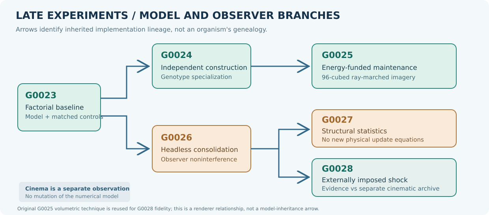

# Ontogenesis

**An artificial-life visualization experiment in computational art, scientific instrumentation, and recursive human–AI creation.**

[**Watch the evolution film**](https://github.com/interrupt21h/ontogenesis/releases/download/atlas-media/ontogenesis-evolution.mp4) · [**Visual gallery**](docs/VISUAL_GALLERY.md) · [**Scientific monograph**](https://github.com/interrupt21h/ontogenesis/releases/download/atlas-media/ontogenesis.pdf) · [**Experiment index**](docs/EXPERIMENTS.md)

> [!NOTE]
> Ontogenesis is exploratory computational art, **not a validated biological model**. Each generation is a separately initialized numerical experiment. Successful CI execution demonstrates the assertions and deliverables tested in that run—not ecological recovery, numerical convergence, or biological life.

## The work

Ontogenesis investigates how local mathematical rules, chemical interaction, four-dimensional geometry, structural memory, and environmental interventions can generate visually unfamiliar forms. The process itself is part of the art: human artistic direction, AI-assisted development, GitHub-hosted numerical execution, and reproducible publication.

The original time-bounded edition unfolded over November 19–20, 2026. Its first recorded numerical execution and automated film-publication milestone were 36 hours, 2 minutes, and 9 seconds apart. This is **elapsed milestone time**, not an estimate of human work. Read the [artist's statement](docs/RECURSIVE_CREATION.md) for the creative method and its limits.

## Watch the evolving universe

**G0028 / Volumetric fidelity master** — 24⁴ lattice, 4,800 integration steps, seven observed fields, four sampled fourth-coordinate hyperplanes, native sample stride 4, 96³ ray integration, and a 60-second 1280 × 720 film. The [full job passed CI](https://github.com/interrupt21h/ontogenesis/actions/runs/44833423671); its artistic effectiveness and biological interpretation are separate questions.

[**Play high-fidelity master (MP4)**](https://github.com/interrupt21h/ontogenesis/releases/download/atlas-media/ontogenesis-0028-fidelity-master.mp4) · [Alternative single-plane cinematic master](https://github.com/interrupt21h/ontogenesis/releases/download/atlas-media/ontogenesis-0028-cinematic.mp4) · [Compare all versions, posters and native archives](docs/VISUAL_GALLERY.md)

The [cumulative evolution film](https://github.com/interrupt21h/ontogenesis/releases/download/atlas-media/ontogenesis-evolution.mp4) selects the **24⁴ G0028 volumetric fidelity master** (60 seconds, 1,440 playback frames) as its final cinematic chapter. The edition is pinned in [`report/videos.json`](report/videos.json) to verified Actions artifact [`14680891214`](https://github.com/interrupt21h/ontogenesis/actions/runs/44833423671/artifacts/14680891214). The earlier 12⁴ preview and alternative single-plane master remain separately archived. G0025 remains the benchmark for assessing volumetric rendering quality; no biological recovery is inferred from camera motion or imagery.

## Current experimental record

| Dimension | Verified scope / publication status |
|:--|:--|
| **Implemented experiments** | G0001–G0028, each documented separately |
| **Full-resolution numerical domain** | 24⁴ periodic cells for the recent full-domain studies |
| **G0026 observer test** | Full 4,800-step matched observer verification passed |
| **G0027 structural statistics** | Full 24⁴ run and 41/41 same-process observer checkpoints passed; cross-run bitwise agreement is not established |
| **G0028 scientific intervention** | 12⁴ paired pilot and [full 24⁴ matched-control run](https://github.com/interrupt21h/ontogenesis/actions/runs/44840239338) both verified; the full study finds 94.35% attenuation in local energy deficit and persistent changes in global matrix coverage |
| **G0028 cinematic observations** | Both full 24⁴ film workflows passed; source numerical archives and distinct posters retained |
| **Published research report** | [Verified scientific/engineering PDF](https://github.com/interrupt21h/ontogenesis/releases/download/atlas-media/ontogenesis.pdf), including the final-render chapter |
| **Compute** | GitHub-hosted CPU Actions; expensive runs are explicitly gated |

### The production process

*Conceptual software workflow; not a measured simulation figure.* [Production and reproducibility guide](docs/PIPELINE.md).

## Follow the experiments

*Late-model ancestry: G0024–G0025's construction/maintenance branch differs from G0026–G0028's measurement/intervention branch. G0028 may reuse G0025's visual techniques without inheriting its equations.*

| Research arc | Generations | Core inquiry |
|:--|:--|:--|
| Chemical differentiation | [G0001–G0005](docs/EXPERIMENTS.md#i--chemical-differentiation) | Symmetry, competition, feedback |
| Transport and energetics | [G0006–G0011](docs/EXPERIMENTS.md#ii--transport-energy-and-signaling) | Circulation, resource coupling, communication |
| Higher dimensions and inheritance | [G0012–G0017](docs/EXPERIMENTS.md#iii--higher-dimensions-and-inheritance) | Hypervolume, identity, evolution |
| Structural development | [G0018–G0023](docs/EXPERIMENTS.md#iv--structure-persistence-and-controls) | Morphogenesis, topology, controls |
| Specialization and maintenance | [G0024–G0025](docs/EXPERIMENTS.md#v--structural-specialization) | Construction, energy-funded maintenance |
| Measurement and instrumentation | [G0026–G0027](docs/EXPERIMENTS.md#vi--measurement-and-instrumentation) | Observer noninterference, structural statistics |
| Environmental disturbance | [G0028](docs/EXPERIMENTS.md#vii--environmental-intervention) | Controlled perturbation, observational cinema |

[**Explore all 28 generations and workflows**](docs/EXPERIMENTS.md) · [Detailed chronological results](docs/HISTORY.md)

> [!IMPORTANT]
> G0029–G0032 are **planned research directions**, not finished simulations. Full-resolution G0028 cinematic output must not be confused with a paired two-universe controlled experiment.

## Reproduce and explore

~~~bash
git clone https://github.com/interrupt21h/ontogenesis.git
cd ontogenesis
python3.12 -m venv .venv
source .venv/bin/activate
python -m pip install -r requirements.txt
python render.py
~~~

Later experiments have workflow-specific requirements such as SciPy. The 24⁴ jobs are expensive: consult the [runbook](docs/PIPELINE.md) before manually dispatching them.

## Read more

| Document | Purpose |
|:--|:--|
| [Documentation index](docs/README.md) | Curated entry points |
| [Visual gallery](docs/VISUAL_GALLERY.md) | Source-film posters, MP4s, numeric archives and caveats |
| [Experiment atlas](docs/EXPERIMENTS.md) | Every generation, source implementation and CI workflow |
| [Complete history](docs/HISTORY.md) | Mathematical changes and actual measured outcomes |
| [Scientific conventions](docs/METHODOLOGY.md) | Numerical and evidentiary limitations |
| [Production / reproducibility](docs/PIPELINE.md) | Safe Actions dispatch, release lifecycle, publication |
| [Recursive creation](docs/RECURSIVE_CREATION.md) | Creative inquiry and AI-assisted authorship |
| [About the artist](docs/AUTHOR.md) | Artistic and scientific background |

**Artistic direction:** Scott Muller. AI provided substantial mathematical and engineering implementation; interpretations remain constrained by recorded evidence. Release media may require GitHub authentication. Linked film posters open **actual retained MP4s**; GitHub READMEs do not provide a reliable arbitrary inline-video player.
