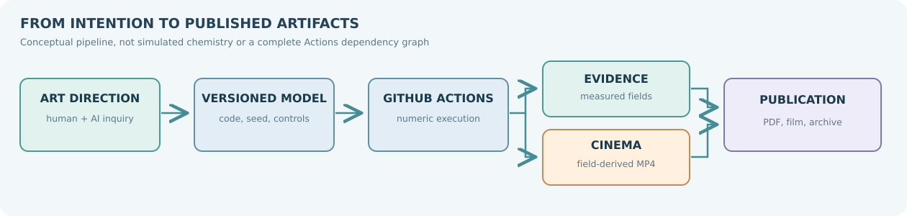

# Ontogenesis

**An artificial-life visualization experiment in computational art, scientific instrumentation, and recursive human–AI creation.**

[**Watch the latest film**](https://github.com/interrupt21h/ontogenesis/releases/download/atlas-media/ontogenesis-0028-cinematic.mp4) · [**Complete evolution**](https://github.com/interrupt21h/ontogenesis/releases/download/atlas-media/ontogenesis-evolution.mp4) · [**Visual gallery**](docs/VISUAL_GALLERY.md) · [**Scientific monograph**](https://github.com/interrupt21h/ontogenesis/releases/download/atlas-media/ontogenesis.pdf) · [**Experiment index**](docs/EXPERIMENTS.md)

> [!NOTE]
> Ontogenesis is exploratory computational art, not a biological model. Each generation is a separate numerical experiment, and its films offer artistic views of the simulated fields.

## The work

Ontogenesis investigates how local mathematical rules, chemical interaction, four-dimensional geometry, structural memory, and environmental interventions can generate visually unfamiliar forms. The process itself is part of the art: human artistic direction, AI-assisted development, GitHub-hosted numerical execution, and reproducible publication.

Developed through a concentrated sequence of experiments in November 2026, the work combines artistic direction, iterative simulation, observation and numerical analysis. The [artist's statement](docs/RECURSIVE_CREATION.md) describes this method and the relationship between human intention and machine-assisted creation.

## Watch the evolving universe

### G0028 · Structures in motion

An evolving landscape of color, structure and movement, rendered from a **24⁴ numerical universe** across 4,800 simulation steps. This 60-second cinematic follows the system before and after a localized environmental disturbance.

[**Watch the latest full-resolution film**](https://github.com/interrupt21h/ontogenesis/releases/download/atlas-media/ontogenesis-0028-cinematic.mp4) · [Complete evolution film](https://github.com/interrupt21h/ontogenesis/releases/download/atlas-media/ontogenesis-evolution.mp4) · [Visual gallery](docs/VISUAL_GALLERY.md)

*The animation is an artistic interpretation of measured numerical fields, not a claim that the system is biologically alive.*

## Research at a glance

| Dimension | Project overview |
|:--|:--|
| **Implemented experiments** | G0001–G0028, each documented separately |
| **Full-resolution numerical domain** | 24⁴ periodic cells for the recent full-domain studies |
| **G0026 observer experiment** | Examines whether recording numerical measurements changes the simulation |
| **G0027 structural analysis** | Studies concentration distributions, spatial frequencies and structural thresholds |
| **G0028 disturbance experiment** | Compares untreated and disturbed 24⁴ universes, revealing changing local energy differences and persistent matrix differences |
| **Featured artwork** | Full-resolution 24⁴ G0028 cinematic; an alternative ray-integrated film remains available |
| **Illustrated monograph** | [Read the scientific and artistic report](https://github.com/interrupt21h/ontogenesis/releases/download/atlas-media/ontogenesis.pdf) |
| **Production** | Python numerical simulation, field-based rendering, and a reproducible research archive |

### The production process

*Conceptual software workflow; not a measured simulation figure.* [Production and reproducibility guide](docs/PIPELINE.md).

## Follow the experiments

*Late-model ancestry: G0024–G0025's construction/maintenance branch differs from G0026–G0028's measurement/intervention branch. G0028 may reuse G0025's visual techniques without inheriting its equations.*

| Research arc | Generations | Core inquiry |
|:--|:--|:--|
| Chemical differentiation | [G0001–G0005](docs/EXPERIMENTS.md#i--chemical-differentiation) | Symmetry, competition, feedback |
| Transport and energetics | [G0006–G0011](docs/EXPERIMENTS.md#ii--transport-energy-and-signaling) | Circulation, resource coupling, communication |
| Higher dimensions and inheritance | [G0012–G0017](docs/EXPERIMENTS.md#iii--higher-dimensions-and-inheritance) | Hypervolume, identity, evolution |
| Structural development | [G0018–G0023](docs/EXPERIMENTS.md#iv--structure-persistence-and-controls) | Morphogenesis, topology, controls |
| Specialization and maintenance | [G0024–G0025](docs/EXPERIMENTS.md#v--structural-specialization) | Construction, energy-funded maintenance |
| Measurement and instrumentation | [G0026–G0027](docs/EXPERIMENTS.md#vi--measurement-and-instrumentation) | Observer noninterference, structural statistics |
| Environmental disturbance | [G0028](docs/EXPERIMENTS.md#vii--environmental-intervention) | Controlled perturbation, observational cinema |

[**Explore all 28 generations and workflows**](docs/EXPERIMENTS.md) · [Detailed chronological results](docs/HISTORY.md)

G0029–G0032 remain future research directions. See the [experiment atlas](docs/EXPERIMENTS.md) for the measured results and their limitations.

## Reproduce and explore

~~~bash
git clone https://github.com/interrupt21h/ontogenesis.git
cd ontogenesis
python3.12 -m venv .venv
source .venv/bin/activate
python -m pip install -r requirements.txt
python render.py
~~~

Later experiments have additional dependencies and substantial computational requirements. See the [reproduction guide](docs/PIPELINE.md).

## Read more

| Document | Purpose |
|:--|:--|
| [Documentation index](docs/README.md) | Curated entry points |
| [Visual gallery](docs/VISUAL_GALLERY.md) | Source-film posters, MP4s, numeric archives and caveats |
| [Experiment atlas](docs/EXPERIMENTS.md) | Every generation, source implementation and CI workflow |
| [Complete history](docs/HISTORY.md) | Mathematical changes and actual measured outcomes |
| [Scientific conventions](docs/METHODOLOGY.md) | Numerical and evidentiary limitations |
| [Production / reproducibility](docs/PIPELINE.md) | Safe Actions dispatch, release lifecycle, publication |
| [Recursive creation](docs/RECURSIVE_CREATION.md) | Creative inquiry and AI-assisted authorship |
| [About the artist](docs/AUTHOR.md) | Artistic and scientific background |

**Artistic direction:** Scott Muller · Human-directed, AI-assisted computational art. Technical provenance and numerical evidence are maintained in the supporting documentation.
