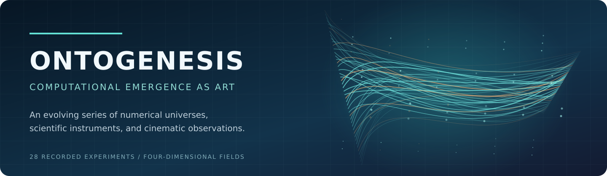

# Ontogenesis

**An unnecessarily elaborate experiment in computational complexity.**

*Part generative art, part evolving simulation, part GitHub Actions endurance test.*

[**Interactive cinema & experiment portal**](https://interrupt21h.github.io/ontogenesis/) · [**Newest: G0035 Morphogenic Tide art film**](https://github.com/interrupt21h/ontogenesis/releases/download/atlas-media/ontogenesis-0035-morphogenic-tide-art.mp4) · [**Watch G0034 Luminous Habitat — art-directed cinematic**](https://github.com/interrupt21h/ontogenesis/releases/download/atlas-media/ontogenesis-0034-luminous-habitat.mp4) · [**Newest: G0034 Lineage Ribbons**](https://github.com/interrupt21h/ontogenesis/releases/download/atlas-media/ontogenesis-0034-lineage-ribbons.mp4) · [**Interactive Lineage Observatory**](https://interrupt21h.github.io/ontogenesis/lineage-observatory.html) · [**Watch G0033 Contact Cartography**](https://github.com/interrupt21h/ontogenesis/releases/download/atlas-media/ontogenesis-0033-contact-cartography.mp4) · [**Explore the interactive Interface Lab**](https://interrupt21h.github.io/ontogenesis/interface-lab.html) · [**Featured G0028 film**](https://github.com/interrupt21h/ontogenesis/releases/download/atlas-media/ontogenesis-0028-cinematic.mp4) · [**Complete evolution**](https://github.com/interrupt21h/ontogenesis/releases/download/atlas-media/ontogenesis-evolution.mp4) · [**Visual gallery**](docs/VISUAL_GALLERY.md) · [**Illustrated field journal (PDF)**](https://github.com/interrupt21h/ontogenesis/releases/download/atlas-media/ontogenesis.pdf) · [**Experiment index**](docs/EXPERIMENTS.md)

## Things got out of hand

Ontogenesis started with a fairly simple idea: build something complicated, let it evolve, make interesting visuals, and see how far GitHub's CI infrastructure could be pushed.

Naturally, it got out of hand.

The result is a growing collection of numerical worlds, rendering pipelines, automated experiments, videos, reports, and the machinery needed to keep them all cooperating. The simulation generates complexity. The production pipeline generates another kind of complexity. Keeping both running is half the project.

**This is not a scientific research program or a claim about artificial life.** The math and measurements are real parts of the software, but the point is exploration, generative art, automation, and the occasional surprise—not establishing biological discoveries.

## Watch the latest experiment

### G0028 · Poking the universe

A 24⁴ numerical domain, 4,800 simulation steps, and a localized disturbance. The 60-second film follows what happens before and after the intervention. It is a cinematic interpretation of numerical fields, not footage of living organisms or proof of recovery.

[**Full-resolution film**](https://github.com/interrupt21h/ontogenesis/releases/download/atlas-media/ontogenesis-0028-cinematic.mp4) · [Complete evolution](https://github.com/interrupt21h/ontogenesis/releases/download/atlas-media/ontogenesis-evolution.mp4) · [Gallery](docs/VISUAL_GALLERY.md)

## Additional cinematic edition · G0029 voxel universe

### G0029 · Circulation with memory

The same **24⁴, 4,800-step G0029 simulation** now has a second cinematic interpretation. This edition uses the glowing voxel-cloud aesthetic of G0028's featured film, with memory, matrix, and the two competing populations translated into a rotating field of light. It is a **60-second, 1280 × 720, 24 FPS** render from the already verified G0029 numerical archive, not a new simulation.

[**Watch the voxel cinematic edition**](https://github.com/interrupt21h/ontogenesis/releases/download/atlas-media/ontogenesis-0029-voxel-cinematic.mp4) · [Original G0029 volumetric film](https://github.com/interrupt21h/ontogenesis/releases/download/atlas-media/ontogenesis-0029-master.mp4) · [Visual gallery](docs/VISUAL_GALLERY.md) · [Render provenance](https://github.com/interrupt21h/ontogenesis/releases/download/atlas-media/ontogenesis-0029-voxel-cinematic.render.json)

*An additional artistic edition, not a replacement for the featured G0028 film. Camera motion, glow, and fourth-axis interpolation are visualization choices, not new simulation dynamics.*

## What is actually happening?

| Part | What it does |
|:--|:--|
| **32 experiment designs** | G0001–G0032 have verified evidence; G0032 produced a seed-dependent spatial-partition result, not proven stable coexistence |
| **Numerical worlds** | Local rules update dimensionless fields on periodic grids; some recent experiments use a 24⁴ domain |
| **Generative visuals** | Field data becomes images, sections, projections, and films |
| **GitHub Actions** | Runs experiments, builds artifacts, and helps turn the repository into a tiny computational production studio |
| **The field journal** | An illustrated PDF of what we tried, what happened, and what the machinery produced |
| **The ongoing challenge** | More elaborate simulations, better visuals, bounded compute, and fewer things falling over |

*Conceptual production diagram, not a numerical simulation result.*

## A tour of the rabbit hole

| Experiments | What we played with |
|:--|:--|
| [G0001–G0005](docs/EXPERIMENTS.md#i--chemical-differentiation) | Patterns, competition, and feedback |
| [G0006–G0011](docs/EXPERIMENTS.md#ii--transport-energy-and-signaling) | Motion, resources, and signals |
| [G0012–G0017](docs/EXPERIMENTS.md#iii--higher-dimensions-and-inheritance) | Extra dimensions, identity, and inherited variation |
| [G0018–G0023](docs/EXPERIMENTS.md#iv--structure-persistence-and-controls) | Structures, connectivity, and what actually persists |
| [G0024–G0025](docs/EXPERIMENTS.md#v--structural-specialization) | Construction and maintenance |
| [G0026–G0027](docs/EXPERIMENTS.md#vi--measurement-and-instrumentation) | Better ways to observe and measure the mess |
| [G0028](docs/EXPERIMENTS.md#vii--environmental-intervention) | Disturbing the system and watching its response |
| [G0029](docs/EXPERIMENTS.md#viii--transport-with-memory) | Persistent circulation memory, with a same-seed matched control |
| [G0030](docs/EXPERIMENTS.md#ix--ecological-controls) | Which direction of metabolite exchange matters after an environmental change? |

G0029's full-domain experiment and alternative cinematic editions passed CI. G0030's two-seed factorial pilot passed CI, but V remained below the active threshold in all eight endpoints and no active co-occupancy was measured. G0028 remains the featured cinematic. G0031's viability frontier and G0032's niche-partition experiment have since been executed and archived; neither establishes robust stable coexistence.

## G0029 · Giving circulation a memory

The latest implementation adds structure-informed curl feedback to the existing four-dimensional flow. [See the experiment](docs/generations/0029.md) and [its workflow](.github/workflows/adaptive-transport.yml). The 12⁴ pilot becomes nearly inactive, whereas the [verified full 24⁴ paired study](https://github.com/interrupt21h/ontogenesis/actions/runs/45232504379) shows more W activity but reduced V and structural-matrix coverage in the adaptive arm. [Watch the G0029 full-resolution alternative](https://github.com/interrupt21h/ontogenesis/releases/download/atlas-media/ontogenesis-0029-master.mp4). G0028 remains the selected cinematic artwork.

## G0030 · Who benefits when the environment changes?

Instead of introducing another speculative mechanism, the new experiment disables and restores each direction of the existing metabolite exchange. Four matched arms and two seeds receive the same mid-run environmental change. The measurable questions are population turnover, metabolite reliance, structural persistence and changing genetic composition.

[**G0030 experiment design**](docs/generations/0030.md) · [Factorial simulation](ecological_succession.py) · [Automated pilot](.github/workflows/ecological-succession.yml)

[**Measured G0030 time series**](https://github.com/interrupt21h/ontogenesis/releases/download/atlas-media/g0030-pilot.png) · [Numerical archive](https://github.com/interrupt21h/ontogenesis/releases/download/atlas-media/g0030-pilot.json)

[**Measured activity-loss analysis**](https://github.com/interrupt21h/ontogenesis/releases/download/atlas-media/g0030-analysis.md): V last exceeded the activity threshold at step 30 and stayed below it from step 60, long before the environmental change at step 600.

[**Early viability comparison**](https://github.com/interrupt21h/ontogenesis/releases/download/atlas-media/g0030-viability.png): neither the unmodified environment nor three early environmental changes preserved active V beyond step 60 under the tested conditions. A viable two-population baseline is now the priority.

[**Watch G0030's animated numerical documentary**](https://github.com/interrupt21h/ontogenesis/releases/download/atlas-media/ontogenesis-0030-diagnostic.mp4) · [Verified poster](https://github.com/interrupt21h/ontogenesis/releases/download/atlas-media/ontogenesis-0030-diagnostic.png)

*The pilot is verified; stable succession and coexistence were not demonstrated. This is data animation, not reconstructed spatial footage. No featured film has been replaced.*

## G0031 · Finding a viable population balance

The experiments now test something more fundamental than adding new complexity: whether modest changes to the existing V loss rate can allow both simulated populations to remain active together. Five matched multipliers, including the historical untouched model, are evaluated across two seeds. Very strong reductions produced invalid or one-sided dynamics and are excluded from the narrower study.

[**G0031 controlled design**](docs/generations/0031.md) · [Numerical implementation](viability_frontier.py) · [GitHub Actions](.github/workflows/viability-frontier.yml)

[**G0031 measured plot**](https://github.com/interrupt21h/ontogenesis/releases/download/atlas-media/g0031-pilot.png) · [Raw numerical observations](https://github.com/interrupt21h/ontogenesis/releases/download/atlas-media/g0031-pilot.json) · [Successful pilot CI](https://github.com/interrupt21h/ontogenesis/actions/runs/45332031263)

*The verified pilot showed that small loss-rate changes can switch the dominant population. None of the tested endpoints maintained active co-occupation. No spatial film has been fabricated from time-series data.*

## G0032 · Can separate habitats keep both populations active?

G0031 showed that slightly reducing V's mortality usually switches which population wins. G0032 tests whether an **externally specified complementary spatial preference** can change that outcome. In the successful [two-seed G0032 numerical study](https://github.com/interrupt21h/ontogenesis/actions/runs/45335396705), seed 73 retained both V and W globally at step 240 for two spatial-niche treatments. Their active cells did not overlap. Seed 42 did **not** reproduce the result.

[**Measured population trajectories**](https://github.com/interrupt21h/ontogenesis/releases/download/atlas-media/g0032-pilot.png) · [Numerical archive](https://github.com/interrupt21h/ontogenesis/releases/download/atlas-media/g0032-pilot.json) · [Experiment methods](docs/generations/0032.md)

The [**verified longer-horizon comparison**](https://github.com/interrupt21h/ontogenesis/actions/runs/45338017117) found that seed 73 still retained both populations globally at step 480 under strong spatial separation (64.26% V and 22.84% W active coverage); seed 42 did not reproduce the outcome.

[**Watch the authentic G0032 spatial cinematic**](https://github.com/interrupt21h/ontogenesis/releases/download/atlas-media/ontogenesis-0032-spatial.mp4) · [Recorded native 4D fields](https://github.com/interrupt21h/ontogenesis/releases/download/atlas-media/g0032-native-fields-seed73.npz) · [Verified rendering](https://github.com/interrupt21h/ontogenesis/actions/runs/45407767981)

The [native 4D interface analysis](https://github.com/interrupt21h/ontogenesis/actions/runs/45410140099) measures **2,806 neighboring faces** between V-only and W-only active regions in seed 73's stronger niche treatment at step 480, while only **two cells** exceed both activity thresholds. [View the actual 4D interface graph](https://github.com/interrupt21h/ontogenesis/releases/download/atlas-media/g0032-spatial-interface.png).

*The film uses real saved four-dimensional fields, unlike the earlier chart animation. It is a fixed-ω hyperplane under display-camera rotation, not an autonomous organism or proof of stable coexistence.*

## Next: G0033 · Testing the spatial interface\n\nThe [G0033 controlled experiment plan](docs/generations/0033.md) defines a bounded, multi-seed follow-up to G0032: replicate the four-dimensional interface across initial conditions, measure its persistence, vary the activity cutoff, and compare against shuffled spatial-mask controls. **This is a proposed experiment, not a completed numerical result or film.**\n\n## G0036 — Feedback Aurora: the simulated world responds

[**Watch the G0036 art film**](https://github.com/interrupt21h/ontogenesis/releases/download/atlas-media/ontogenesis-0036-feedback-aurora-art.mp4) · [**Watch the exact numerical evidence film**](https://github.com/interrupt21h/ontogenesis/releases/download/atlas-media/ontogenesis-0036-feedback-aurora-evidence.mp4) · [**Read the G0036 study**](docs/generations/0036.md) · [**Verified numerical CI**](https://github.com/interrupt21h/ontogenesis/actions/runs/45486825879)

G0036 is our newest **actual numerical intervention**, not merely a new artistic treatment of archived fields. A bounded divergence-free four-dimensional velocity correction depends on the solver's *current* structural matrix and V/W population imbalance. The control uses the unmodified integrator with the same starting seed and prescribed habitat. Two independently initialized seeds were tested through 120 steps on a 12⁴ native grid. Both matched-control numerical runs and both Feedback Aurora cinematic editions passed GitHub Actions.

The art film reveals the **measured difference made by feedback** as an aurora-like field of sculptural contour ridges, then stages the original and intervention at identical recorded final states. The evidence film instead displays the actual 12×12 projected cells without smoothing. The effect was genuinely seed-dependent: the full-field mean absolute V concentration difference at step 120 was about **0.00243** in seed 42 and **0.01216** in seed 73. This establishes sensitivity to a prescribed numerical feedback rule, not emergent intelligence or autonomous biological life.

## Latest cinematic experiment: G0035 Morphogenic Tide

[**Watch Morphogenic Tide — Art Film**](https://github.com/interrupt21h/ontogenesis/releases/download/atlas-media/ontogenesis-0035-morphogenic-tide-art.mp4) · [**Watch the evidence film**](https://github.com/interrupt21h/ontogenesis/releases/download/atlas-media/ontogenesis-0035-morphogenic-tide-evidence.mp4) · [**Read the experiment record**](docs/generations/0035.md) · [**Verified cinematic workflow**](https://github.com/interrupt21h/ontogenesis/actions/runs/45480155128)

The newest film treats original four-dimensional concentration fields as the material for **sculptural luminous contour cinema**. A sequence of measured omega hyperplanes becomes layered cyan, amber and violet isobands that reveal distinct spatial morphology under complementary-niche versus no-niche conditions. This is not another animated graph, particle cloud or pseudo-biological illustration.

G0035 deliberately ships **two cinematic masters**, 24 seconds each: an art-directed film and an exact-grid numerical evidence companion. Both use the same authenticated G0033 seed-73 field archive. The art film uses presentation-space bicubic contour interpolation and light; the evidence film shows discrete native projected cells with recorded thresholds. Neither runs new solver steps or claims organisms.

A [release-level coverage check](.github/workflows/recent-cinematic-coverage.yml) now verifies that every recent generation G0030–G0035 has its published video editions and posters. **Numerical provenance, artistic quality and visual completeness are independently checked**, rather than inferred from a successful job.

## A world to look at: G0034 Luminous Habitat

[**Watch the 24-second film**](https://github.com/interrupt21h/ontogenesis/releases/download/atlas-media/ontogenesis-0034-luminous-habitat.mp4) · [**Explore our visual art direction**](docs/ART_DIRECTION.md) · [**Verify the actual native source and renderer**](.github/workflows/g0034-luminous-habitat.yml)

Ontogenesis increasingly treats its numerical algorithms as the material for **original generative cinema**. The new Luminous Habitat uses actual recorded four-dimensional concentration fields to create an atmospheric, bioluminescent world of translucent-looking structures and faithfully drawn native neighbor filaments. Its three acts show seed 73 with imposed complementary niches, a matched no-niche control, and the visually divergent worlds placed together. Cinematic lighting and camera movement are presentation, not fabricated ecology.

The project follows an explicit [art direction and visual review contract](docs/ART_DIRECTION.md): each new film must be artistically distinctive, genuinely driven by its algorithm, legible as an independent work of art, and transparent about what is recorded data versus creative treatment. Diagnostic plots and numerical reports remain available separately; the aim is **an immersive encounter with artificial-life-inspired worlds**, not to imply that autonomous biological organisms have been demonstrated.

## Newest visual experiment: G0034 Lineage Ribbons

[**Watch the 24-second Lineage Ribbons film**](https://github.com/interrupt21h/ontogenesis/releases/download/atlas-media/ontogenesis-0034-lineage-ribbons.mp4) · [**Explore G0034 native topology interactively**](https://interrupt21h.github.io/ontogenesis/lineage-observatory.html) · [**Read the full algorithm and measured evidence**](docs/generations/0034.md)

G0034 turns the project’s recorded **four-dimensional connected components** into a branching diagram of directly observed numerical continuity. Instead of more particle clouds, every node is a face-connected region in a true periodic 4D lattice and every connecting ribbon records actual overlapping sites between consecutive sampled states. The film depicts the real seed-dependent changes in V-only and W-only structures. The companion site exposes both controls, both seeds, exact sample times and graph-event counts.

This is **a new observational algorithm applied to archived G0033 states**, not a newly evolved organism or an independent numerical run. Graph splitting, merging and disappearing mean thresholded overlap events, not biological reproduction or death. The whole source dataset and rendering workflow are published independently of the artwork.

## New visual edition: G0033 Temporal Loom

[**Watch the verified eight-seed Temporal Loom film**](https://github.com/interrupt21h/ontogenesis/releases/download/atlas-media/ontogenesis-0033-temporal-loom.mp4) · [**Explore measured histories on GitHub Pages**](https://interrupt21h.github.io/ontogenesis/temporal-loom.html) · [**Review the exact numerical JSON**](https://github.com/interrupt21h/ontogenesis/releases/download/atlas-media/g0033-temporal-loom.json)

The new kinetic heatmap makes the **timing and seed dependence of four-dimensional interfaces** visible across eight independently initialized numerical trajectories and two matched habitat treatments. Unlike the volumetric and Contact Cartography films, this edition shows **all eight seeds simultaneously**, using eleven actual numerical observations each (steps 0, 24, …, 240). The cursor and colors are visual tools; no undocumented states are synthesized. The interactive version supports three activity thresholds and six measured quantities.

## The newest visual world: G0033 Contact Cartography

The [G0033 Contact Cartography film](https://github.com/interrupt21h/ontogenesis/releases/download/atlas-media/ontogenesis-0033-contact-cartography.mp4) presents two genuinely different 4D populations through a **16-plane fourth-axis atlas** instead of another conventional rotating particle cloud. It highlights real exclusively V-active/W-active neighboring faces along all four periodic numerical axes, with recorded numerical timesteps only. The [eight-seed Interface Lab](https://interrupt21h.github.io/ontogenesis/interface-lab.html) lets viewers select thresholds, treatments and observed endpoint statistics from the [verified G0033 robustness pilot](https://github.com/interrupt21h/ontogenesis/actions/runs/45437009050). The light and camera movement are visualization, not extra physical timesteps or evidence of life.

## Interactive cinema and GitHub Pages\n\nThe [**Ontogenesis cinema portal**](https://interrupt21h.github.io/ontogenesis/) is built with GitHub Pages and discovers actual playable films from the public `atlas-media` release inventory. It includes the historic G0001–G0032 gallery and additional editions only when successfully published. [GitHub Pages deployment workflow](.github/workflows/pages.yml). If the site has not been enabled yet, choose **GitHub Actions** under repository Settings → Pages; a successful deployment is required before the URL becomes live.\n\nG0033's [eight-seed numerical workflow](.github/workflows/g0033-robustness.yml), [paired-seed cinematic](.github/workflows/g0033-native-cinema.yml), and [Contact Cartography workflow](.github/workflows/g0033-contact-cartography.yml) have passed CI, with numerical evidence and both cinematic editions published on the `atlas-media` release. The monograph remains a separately curated, 32-generation historical edition.\n\n## Every generation, visualized

The [**complete G0001–G0032 visual atlas**](docs/VISUAL_INDEX.md) brings together all 32 generations with actual archived posters, original films, measured diagrams, and source-linked numerical evidence. For a filterable, in-browser player layout, open the [interactive HTML edition](docs/visual-atlas.html). The G0031 and G0032 [measured-data films](docs/VISUAL_GALLERY.md) complement the full-domain G0028/G0029 cinematics without inventing unrecorded spatial states.

## Try it yourself

~~~bash
git clone https://github.com/interrupt21h/ontogenesis.git
cd ontogenesis
python3.12 -m venv .venv
source .venv/bin/activate
python -m pip install -r requirements.txt
python render.py
~~~

Later experiments have additional dependencies and can require substantial CPU time, memory, and storage. See the [pipeline and reproduction guide](docs/PIPELINE.md) before launching the heavier runs.

## The notebooks and machinery

| Read | Why |
|:--|:--|
| [Documentation hub](docs/README.md) | Find your way around |
| [Visual gallery](docs/VISUAL_GALLERY.md) | Watch the results |
| [Experiment atlas](docs/EXPERIMENTS.md) | Browse all generations |
| [Experiment history](docs/HISTORY.md) | See what changed and what was measured |
| [Numerical notes](docs/METHODOLOGY.md) | Understand the math and its limitations |
| [CI and production guide](docs/PIPELINE.md) | Keep the machinery running |
| [On delegating complexity](docs/RECURSIVE_CREATION.md) | How human direction and AI assistance shaped the project |
| [About the creator](docs/AUTHOR.md) | Background |

**Created and directed by Scott Muller.** AI-assisted implementation, GitHub-hosted execution, and a great deal of babysitting complexity. The numerical records remain available so the pretty pictures don't have to carry the burden of proof.
