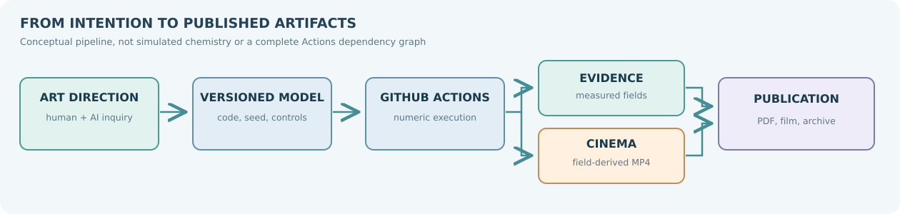

# Production and reproducibility

[← Project overview](../README.md) · [Documentation index](README.md) · [Experiments](EXPERIMENTS.md) · [Visual gallery](VISUAL_GALLERY.md)

*Software production overview, not numerical field output or a complete GitHub Actions trigger-dependency graph.*

## The model and publication layers

Ontogenesis separates numerical integration, source-field observation, visual rendering and publication. That separation protects scientific provenance while allowing experimentation with distinct artistic techniques.

| Layer | Source of truth | Output |
|:--|:--|:--|
| Numerical model | Per-generation Python programs and [experiment records](EXPERIMENTS.md) | Simulated state evolution, controls, numerical metrics |
| Experiment execution | [GitHub Actions workflows](../.github/workflows/) | Verified sampled fields, diagnostics, encoded media |
| Numerical evidence | Archived JSON/NPZ or field-state tarballs | Real observations with source revision, seed, lattice and cadence |
| Selected cumulative film | [Film generator](../report/film.py) and [media manifest](../report/videos.json) | Versioned source-film sequence and combined MP4 |
| Monograph | [Report builder](../report/build.py), [editorial source](../report/introduction.md), [history](HISTORY.md) | Illustrated LaTeX/PDF, quantitative atlas, final-render chapter |
| Durable publication | [`atlas-media` release](https://github.com/interrupt21h/ontogenesis/releases/tag/atlas-media) | Published MP4s, source archives, provenance manifests and PDF |

Historical GitHub Actions artifacts normally have **30-day retention**; cited long-term assets should also be held in the release. A stable release filename may be replaced as a later edition is verified: use accompanying source SHA, archive hashes and run IDs to distinguish revisions.

## Current full-resolution evidence and manual gates

| Experiment / output | Workflow | Current verified state |
|:--|:--|:--|
| G0024 construction | [`specialization.yml`](../.github/workflows/specialization.yml) | Full simulation and field archive retained |
| G0025 maintenance | [`maintenance.yml`](../.github/workflows/maintenance.yml) | Full simulation and visual-quality baseline retained |
| G0026 observer independence | [`consolidation.yml`](../.github/workflows/consolidation.yml) | Full 24⁴ verification passed |
| G0027 structural statistics | [`structural-statistics.yml`](../.github/workflows/structural-statistics.yml) | Full 24⁴ metrics and 41 matching same-process checkpoints passed |
| G0028 matched treatment/control | [`disturbance.yml`](../.github/workflows/disturbance.yml) | Pilot and [24⁴ full paired science run](https://github.com/interrupt21h/ontogenesis/actions/runs/44840239338) both passed; report integrates them as separate evidence plates |
| G0028 full cinematic | [`disturbance-cinematic.yml`](../.github/workflows/disturbance-cinematic.yml) | 24⁴, 60-second moving-field master; selected for cumulative film and report gallery (artifact `14679397104`) |
| G0028 alternate volumetric film | [`disturbance-fidelity.yml`](../.github/workflows/disturbance-fidelity.yml) | 24⁴ multi-plane ray-integrated edition, archived separately (artifact `14680891214`) |
| G0028 render-only updates | [`disturbance-fidelity-rerender.yml`](../.github/workflows/disturbance-fidelity-rerender.yml) | Uses existing NPZ source instead of recomputing a universe |
| G0029 adaptive transport | [Workflow](../.github/workflows/adaptive-transport.yml) | [24⁴ paired run and 60-second master verified](https://github.com/interrupt21h/ontogenesis/actions/runs/45232504379); future full reruns manual only |
| PDF / cumulative movie | [`report.yml`](../.github/workflows/report.yml) / [`film.yml`](../.github/workflows/film.yml) | Both have verified publication runs; media selection and evidence inputs must be updated deliberately |

**The full 24⁴ paired experiment has already passed. Do not rerun it simply to refresh a PDF.** The two-arm study is considerably more expensive than a single cinematic universe; archived numerical JSON can be reused when changing the report.

### GitHub CLI

~~~bash
# Inspect the already verified full paired-control run.
gh run view 44840239338 --repo interrupt21h/ontogenesis --json status,conclusion,jobs

# Run only when an existing successful/full job is absent and no run is active.
gh workflow run disturbance.yml \
  --repo interrupt21h/ontogenesis \
  --ref main \
  -f full_resolution=true

# Rerender a retained full-fidelity archive; the integrator is not rerun.
gh workflow run disturbance-fidelity-rerender.yml \
  --repo interrupt21h/ontogenesis \
  --ref main \
  -f edition=full -f seconds=60
~~~

## Observations versus cinematic frames

The G0028 high-fidelity model evolves **24⁴ (331,776) lattice cells**. Its cinematic observer records seven fields at four selected fourth-dimensional hyperplanes at 1,203 native times and retains eight native **float32 4D seven-field observations**. Frequent visual samples are float16; the renderer interpolates them and ray-integrates a 96³ display grid to produce 1280 × 720 H.264 frames.

Rendered pixels are **not** independent numerical unknowns. Neither temporal interpolation nor moving camera coordinates create new numerical integration steps. The archived fields are **not a restart checkpoint**: complete integrator state, RNG continuation and validated restart equivalence are not retained.

## Release and scientific publication checklist

1. Verify the numerical run and its actual assertions, source SHA, seed, physical constants, and lattice configuration.
2. Verify the field schema, sample cadence, observation precision and measured JSON/NPZ assets separately from encoded MP4s.
3. Label conceptual illustrations, measured diagrams and artistic renderings distinctly.
4. Visually inspect a candidate film across formation, intervention and aftermath; passing FFmpeg is **not** an artistic review.
5. Promote the selected video by editing [`report/videos.json`](../report/videos.json) only when its captions and provenance are updated.
6. Update the scientific interpretation and measured plates separately. **Rerunning the PDF alone cannot incorporate an unreviewed full paired G0028 experiment** if its evidence input still selects the small pilot.
7. Rebuild the cumulative film and report; verify the generated PDF chapter audit and video decodability.
8. Retain unselected cinematic versions with their own manifests; never overwrite scientific evidence with a prettier film.

## Reproduce locally

~~~bash
git clone https://github.com/interrupt21h/ontogenesis.git
cd ontogenesis
python3.12 -m venv .venv
source .venv/bin/activate
python -m pip install -r requirements.txt
python -m pip install scipy==1.15.3  # required by later generations

python render.py                # lightweight initial generation
python scripts/check_docs.py    # static Markdown link validation
~~~

The full monograph build additionally uses Pandoc, LaTeX, latexmk, librsvg2-bin, FFmpeg and numerical plotting dependencies; see [the actual workflow](../.github/workflows/report.yml) for a maintained build recipe.

The art project is isolated from employer hardware: the recorded production processes are GitHub-hosted CPU Actions, not company GPUs, self-hosted runners, or corporate credentials.

## G0029: guarded paired experiment

The G0029 code-path change launches a matched 12⁴ pilot on GitHub-hosted CPU runners. Its first pilot completed successfully ([run 45228921856](https://github.com/interrupt21h/ontogenesis/actions/runs/45228921856)) with paired native field data and a 288-frame MP4; the endpoint populations have zero thresholded activity. The [high-resolution, two-arm 24⁴ experiment](https://github.com/interrupt21h/ontogenesis/actions/runs/45232504379) and its 96³ ray-integrated movie completed successfully on November 23, 2026: 4,800 simulated steps per arm, 1,201 paired samples, ~1 h 52 min simulation, and a 4 min rendering stage. The endpoint shifts active W coverage upward and V and matrix coverage downward. The ~506 MB native field archive and 1,440-frame master are independently retained. Future expensive reruns remain deliberately gated:

~~~bash
gh workflow run adaptive-transport.yml --repo interrupt21h/ontogenesis --ref main -f full_resolution=true
~~~

Examine the [full numerical contrasts](https://github.com/interrupt21h/ontogenesis/releases/download/atlas-media/g0029-full.json), execution cost, [film](https://github.com/interrupt21h/ontogenesis/releases/download/atlas-media/ontogenesis-0029-master.mp4), and native archives before considering further variations. Passing numerical and video CI still does not authorize automatically replacing the verified G0028 feature film or changing the cumulative media manifest.

The user-requested one-time 24⁴ master was run on commit `6c0022c6` and is now archived. Its temporary commit-message trigger was removed afterward. Ordinary push commits cannot start expensive master jobs; rerunning requires explicit GitHub Actions manual dispatch.

## G0030: controlled ecological succession screen

The [G0030 workflow](../.github/workflows/ecological-succession.yml) runs four factorial cross-feeding configurations under an identical deterministic supply-gradient reversal. The automatic pilot is **16⁴ cells × 1,200 steps**, with two seeds (42 and 73), eight sequential runs total, and native numerical measurements every 30 steps and at the environmental event. It produced [verified measured JSON](https://github.com/interrupt21h/ontogenesis/releases/download/atlas-media/g0030-pilot.json) and a [measured trajectory plot](https://github.com/interrupt21h/ontogenesis/releases/download/atlas-media/g0030-pilot.png) in [CI run 45266523722](https://github.com/interrupt21h/ontogenesis/actions/runs/45266523722), **not** an additional film. All eight endpoints had 0% V activity and co-occupancy above their thresholds; W coverage depended on treatment and seed. The pilot took 15:42 on GitHub-hosted CPU. Regression tests protect unchanged G0026 dynamics.

The expensive one-seed **24⁴ × 4,800-step, four-arm** experiment remains explicitly gated; it is not launched on push. Review the bounded pilot and CPU expense before deciding to run:

~~~bash
gh workflow run ecological-succession.yml --repo interrupt21h/ontogenesis --ref main -f full_domain=true
~~~

The [successful archived-data-only posthoc workflow](../.github/workflows/g0030-analysis.yml) measures observed activity-loss intervals, W endpoint differences, and time-integrated co-occupancy using the original saved data. Its [published result](https://github.com/interrupt21h/ontogenesis/releases/download/atlas-media/g0030-analysis.md) found V below the threshold from sample 60 onward, before the step-600 event. No simulation is rerun. A persistent two-population baseline and a no-supply-reversal control are prerequisites for interpreting future succession claims.

The [separate early-viability workflow](../.github/workflows/ecological-viability.yml) also passed. Four matched conditions per seed, 16⁴ cells, 180 steps and a six-step observation cadence compared unchanged spatial supply to inversions at steps 12/24/48. Its [numerical JSON](https://github.com/interrupt21h/ontogenesis/releases/download/atlas-media/g0030-viability.json) and [measured graph](https://github.com/interrupt21h/ontogenesis/releases/download/atlas-media/g0030-viability.png) document that none of the early supply changes preserved V thresholded activity. This bounded CI study cost approximately 3 minutes 12 seconds and 156 MiB peak process RSS; it did not invoke the full 24⁴ simulation.

Population coverage changes are not, by themselves, evidence of mutualism, stable succession or functional organisms.

## G0030 documentary and G0031 viability frontier

[The G0030 documentary renderer](../.github/workflows/ecological-diagnostic.yml) is independent of simulation. It downloads the [factorial](https://github.com/interrupt21h/ontogenesis/releases/download/atlas-media/g0030-pilot.json) and [early viability](https://github.com/interrupt21h/ontogenesis/releases/download/atlas-media/g0030-viability.json) archives and animates their actual observations to [a separate film](https://github.com/interrupt21h/ontogenesis/releases/download/atlas-media/ontogenesis-0030-diagnostic.mp4). Its frame count, decoding, dimensions and input hashes passed [render-only CI](https://github.com/interrupt21h/ontogenesis/actions/runs/45332177291). It does not invent simulated field snapshots and does not change the selected G0028 cinematic.

G0031 implements a matched five-rate 16⁴, 240-step V-loss scan in [its own workflow](../.github/workflows/viability-frontier.yml). An explicit optional parameter in the baseline numerical integrator preserves the historical default. The regression tests compare state hashes against the original default, and an earlier extreme-rate numerical instability is not ignored or clipped. The [bounded G0031 pilot](https://github.com/interrupt21h/ontogenesis/actions/runs/45332031263) passed CI and published [its numerical JSON](https://github.com/interrupt21h/ontogenesis/releases/download/atlas-media/g0031-pilot.json) and [measured figure](https://github.com/interrupt21h/ontogenesis/releases/download/atlas-media/g0031-pilot.png). At 16⁴ cells over 240 steps, all five controlled V-loss settings yielded zero thresholded co-occupation at the endpoint. Small reductions flipped the dominant species in a seed-dependent interval. Full 24⁴ runs remain manual-only and were not triggered.

## G0032: complementary niches and measured spatial partitioning

The [G0032 bounded study](../.github/workflows/niche-screen.yml) introduces one **opt-in** growth preference parameter on the existing four-dimensional static habitat field. The unchanged model and near-transition V mortality are matched controls. For each seed the four arms start from identical state hashes; no new model species or autonomous habitat choices are introduced.

The [verified 16⁴, 240-step pilot](https://github.com/interrupt21h/ontogenesis/actions/runs/45335396705) published [native JSON observations](https://github.com/interrupt21h/ontogenesis/releases/download/atlas-media/g0032-pilot.json) and the [real six-panel time-series plate](https://github.com/interrupt21h/ontogenesis/releases/download/atlas-media/g0032-pilot.png). Seed 73's spatially biased treatments retained both active V and W but with zero same-cell co-occupation at the endpoint. Seed 42 remained single-species active. This **seed-sensitive spatial partitioning** warrants a controlled longer-duration check, not a claim of stable coexistence. The original 240-step pilot did **not** record 4D field snapshots; a [separate step-480 numerical repetition](https://github.com/interrupt21h/ontogenesis/actions/runs/45338017117) now measures longer-horizon persistence, and the [native spatial workflow](../.github/workflows/niche-spatial.yml) subsequently recorded **actual four-dimensional float32 fields** at 21 timesteps for seed 73's no-niche and strong-niche arms. The [corresponding spatial cinematic](https://github.com/interrupt21h/ontogenesis/releases/download/atlas-media/ontogenesis-0032-spatial.mp4) uses a fixed ω=8 slice and camera motion. The source NPZ and two provenance JSON files are archived; the earlier chart animation must still be labeled differently.

## G0032 native 4D interface measurement

[The native interface workflow](../.github/workflows/niche-interface.yml) uses archived native float32 fields directly (not rendered video frames) to enumerate V-only and W-only neighboring faces in the complete periodic 4D grid. Its unit tests verify known exact contact counts for a synthetic split-domain case. For seed 73 at step 480, the spatially biased treatment showed 2,806 exclusive-population faces and two active same-cell overlaps; the no-niche comparator had no active V. The [published diagnostic graph](https://github.com/interrupt21h/ontogenesis/releases/download/atlas-media/g0032-spatial-interface.png) and [JSON time series](https://github.com/interrupt21h/ontogenesis/releases/download/atlas-media/g0032-spatial-interface.json) identify the exact numerical counts. The result describes spatial adjacency, not causal cross-feeding or biological walls.
