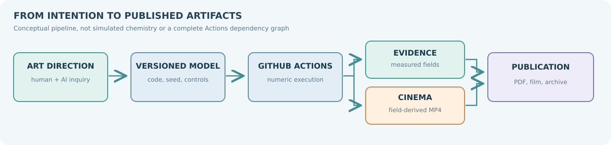

# Documentation

[← Ontogenesis](../README.md)

Ontogenesis is a series of numerical experiments, a computational-art film archive and an account of human-directed, AI-assisted creation. Choose a reading path according to your purpose.

| Goal | Start here |
|:--|:--|
| Watch the actual art | [Visual gallery, posters, MP4s and field archives](VISUAL_GALLERY.md) |
| Understand each generation | [Complete experiment index](EXPERIMENTS.md) |
| Review measurements and numerical claims | [Scientific history](HISTORY.md) |
| Read the illustrated publication | [Latest monograph PDF](https://github.com/interrupt21h/ontogenesis/releases/download/atlas-media/ontogenesis.pdf) |
| Examine methodological limits | [Numerical conventions and evidence standards](METHODOLOGY.md) |
| Reproduce results or rerender images | [Production and CI guide](PIPELINE.md) |
| Explore the conceptual art practice | [Recursive creation, artist's statement](RECURSIVE_CREATION.md) |
| Learn about the artist | [Author biography](AUTHOR.md) |

## Three different kinds of figure

**Measured plots** summarize archived numerical values; **conceptual diagrams** explain hypotheses or control flow without depicting measured fields; **cinematic renderings** transform measured fields into luminous, moving images. Their colors and motion may include camera trajectories, ray integration or interpolation, but those are not additional physics.

G0001–G0028 are recorded, with documented limitations and varying degrees of numerical verification. G0029–G0032 are proposals. New generation documents begin with the [record template](GENERATION_TEMPLATE.md); production changes should satisfy the [methodology](METHODOLOGY.md) and [link validation](PIPELINE.md).
