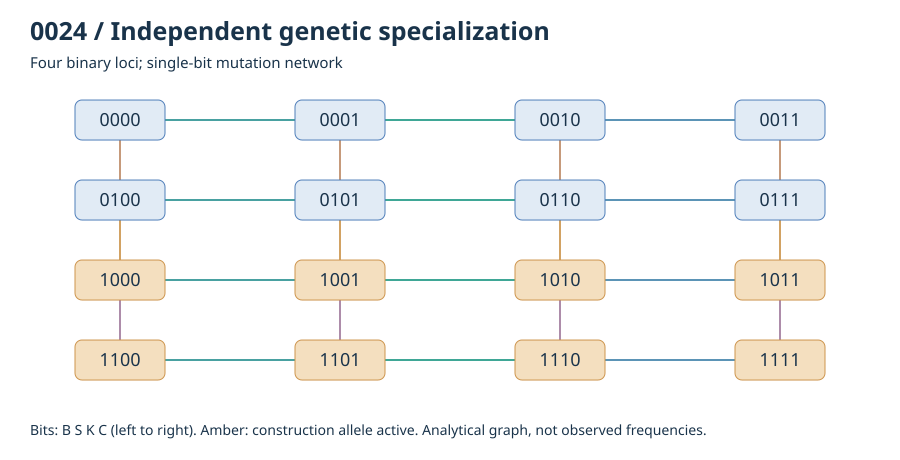
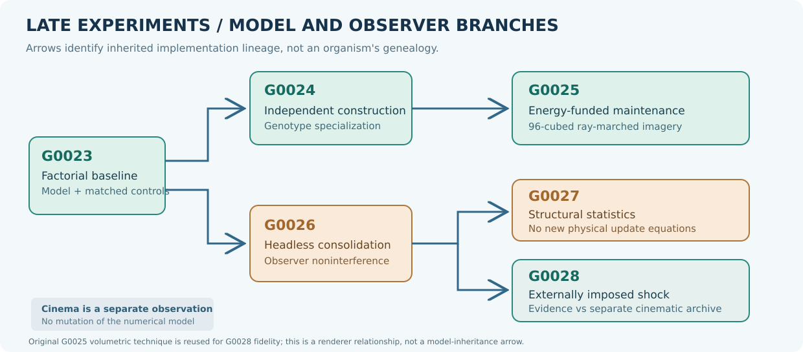
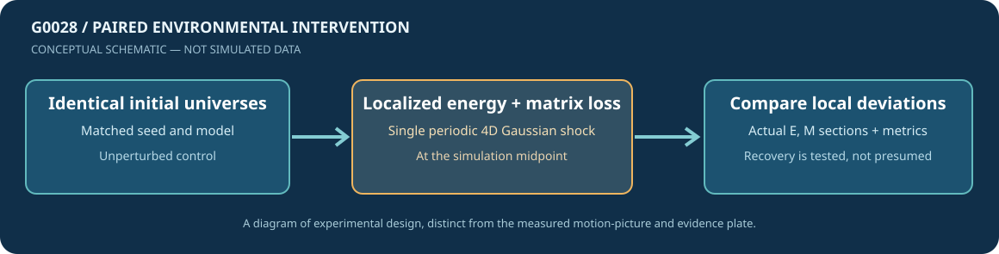

# Visual atlas — films and observations

[← Project overview](../README.md) · [Documentation](README.md) · [Experiments](EXPERIMENTS.md) · [Monograph (PDF)](https://github.com/interrupt21h/ontogenesis/releases/download/atlas-media/ontogenesis.pdf)

**Ontogenesis publishes numerical evidence and moving visual artwork separately.** The linked poster images below are actual retained outputs of their corresponding successful rendering workflows. Conceptual mechanism figures are explicitly labeled; they must never be confused with simulated field images.

**New verified alternative:** [G0029 adaptive transport](generations/0029.md) completed a matched full-domain study and 60-second high-resolution cinematic. Its reduced-domain pilot was near-inactive, while the full run retained activity but shifted coverage between species. G0029 is separately accessible, **not automatically selected** for the cumulative film. The featured G0028 master remains unchanged.

## Additional full-domain G0029 study — not featured

**[Watch the 60-second G0029 master](https://github.com/interrupt21h/ontogenesis/releases/download/atlas-media/ontogenesis-0029-master.mp4)** · [24⁴ paired numerical comparison](https://github.com/interrupt21h/ontogenesis/releases/download/atlas-media/g0029-full.json) · [Source fields](https://github.com/interrupt21h/ontogenesis/releases/download/atlas-media/g0029-full.npz)

This full run records 1,201 measured fourth-axis samples and ray-integrates five native fields with a 96³ presentation grid. Its 24⁴ control and feedback arms diverge in species coverage, not in a proven improvement to survival or life-like behavior. The rendered still is an actual archived frame, not a schematic.

## Featured artwork — G0028 full-resolution cinematic

**[Watch the full-resolution G0028 film (60 seconds)](https://github.com/interrupt21h/ontogenesis/releases/download/atlas-media/ontogenesis-0028-cinematic.mp4)** · [Watch the cumulative evolution](https://github.com/interrupt21h/ontogenesis/releases/download/atlas-media/ontogenesis-evolution.mp4) · [View numerical source data](https://github.com/interrupt21h/ontogenesis/releases/download/atlas-media/cinematic-full.npz)

The latest selected film follows a **24⁴, 4,800-step numerical simulation** through changing concentrations and structural activity. Its rotating projection gives a spatial impression of a fixed fourth-coordinate slice; movement, color and lighting are visual treatments of recorded numerical fields.

## Alternate full-domain volumetric study

**[Watch the volumetric alternative](https://github.com/interrupt21h/ontogenesis/releases/download/atlas-media/ontogenesis-0028-fidelity-master.mp4)** · [Source field archive](https://github.com/interrupt21h/ontogenesis/releases/download/atlas-media/cinematic-fidelity-full.npz) · [Rendering metadata](https://github.com/interrupt21h/ontogenesis/releases/download/atlas-media/ontogenesis-0028-fidelity-master.render.json)

This independently completed **24⁴** edition samples four fourth-coordinate hyperplanes and renders their seven observed fields with 96³ volumetric ray integration. It emphasizes smooth field variation rather than the featured film's granular structures. Both are full-resolution simulations, but their rendered appearances differ because their observation and presentation methods differ.

## G0028 — Reduced-domain cinematic preview

**[Watch the verified 18-second preview](https://github.com/interrupt21h/ontogenesis/releases/download/atlas-media/ontogenesis-0028-preview.mp4)** · [CI run](https://github.com/interrupt21h/ontogenesis/actions/runs/44829195043) · [Historical video artifact `14675921895`](https://github.com/interrupt21h/ontogenesis/actions/runs/44829195043/artifacts/14675921895)

This reduced-domain 12⁴ version is an early rendering study. The selected cumulative-film chapter now uses the full 24⁴ cinematic master. Because its active chemical fields decay early, its moving virtual camera should not be mistaken for continuous simulated organism growth. The newly selected 24⁴ film is an artistic observation of one universe, not the paired causal experiment.

## Earlier visual benchmarks: G0024 and G0025

| G0024 — Independent construction | G0025 — Energy-funded maintenance |
|:--|:--|
|  |  |
| [**Watch the verified G0024 MP4**](https://github.com/interrupt21h/ontogenesis/releases/download/atlas-media/video-0024-14657517295.mp4) · [Experiment](generations/0024.md) | [**Watch the verified G0025 MP4**](https://github.com/interrupt21h/ontogenesis/releases/download/atlas-media/video-0025-14658013645.mp4) · [Experiment](generations/0025.md) |

The two figures above are **conceptual documentation graphics**, not screenshots. The original films and monograph contain the actual observed images. The 96³ volumetric ray integration in G0025 is the established **minimum visual-quality reference** for later high-fidelity editions.

## Scientific evidence: G0028 paired intervention

*Conceptual intervention design, not simulated field data.*

The [verified 12⁴ paired pilot](https://github.com/interrupt21h/ontogenesis/actions/runs/44824014028/artifacts/14673655018) measured approximately **99.16% attenuation** of the *local energy difference relative to control* and **89.09% attenuation** of the *local matrix difference relative to control* by its endpoint. Those percentages **do not imply return to the pre-shock matrix concentration**. The [24⁴ full paired-control experiment](https://github.com/interrupt21h/ontogenesis/actions/runs/44840239338) subsequently passed its numerical and media workflow. In that 4,800-step run, local energy-difference magnitude attenuated by 94.35% and the matrix difference crossed from -0.088706 to +0.010600. At the endpoint the disturbed arm had 5.00% matrix coverage above 0.20 versus 10.50% in the control. These are measured distributions, not evidence of a restored mature ecology.

## The complete visual publication

[**Complete evolution film (MP4)**](https://github.com/interrupt21h/ontogenesis/releases/download/atlas-media/ontogenesis-evolution.mp4) · [**Scientific monograph with curated final-render plates (PDF)**](https://github.com/interrupt21h/ontogenesis/releases/download/atlas-media/ontogenesis.pdf) · [Source video selection](../report/videos.json) · [Publication pipeline](PIPELINE.md)

> [!NOTE]
> The linked posters are preview images; click to view the **actual preserved videos**. GitHub README pages do not reliably support arbitrary inline HTML video playback, so release-linked posters are used rather than misleading embedded-video placeholders. Some private-repository release links require authentication.
