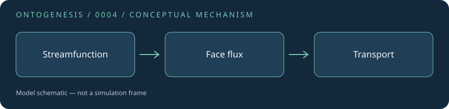

# Generation 0004 — Dynamics



*Conceptual mechanism diagram; not measured simulation imagery.*

**Research question:** How does circulation affect spatial organization?

### Implementation and parameters

Adds prescribed time-dependent streamfunction and conservative first-order upwind transport before each chemical update.

### Mathematical model

```math
\begin{gathered}
\psi=2[\sin(x+0.002t)\sin y\\
\qquad+0.5\cos(2x-y-0.002t)]\\
v_x=d_y\psi,\quad v_y=-d_x\psi\\
F_i=\max(v_i,0)A+\min(v_i,0)A_{+i}\\
A'=A+\sum_i(F_{-i}-F_i)
\end{gathered}
```

Here $A_{+i}$ is the adjacent cell value in the positive direction.

### Visualization and observed results

201 frames; final active V 15.33%, W 63.36%; means 0.039153 and 0.161751.

### Interpretation and limitations

Flow is externally prescribed; upwind scheme introduces numerical diffusion.

### Reproduction and provenance

- [Source](../../dynamics.py) · [Workflow](../../.github/workflows/dynamics.yml)
- [Successful CI run](https://github.com/interrupt21h/ontogenesis/actions/runs/44457874425)
- [Standalone MP4](https://github.com/interrupt21h/ontogenesis/actions/runs/44457874425/artifacts/14498867472) (1,088,828 bytes)
- Run from repository root: `python dynamics.py` after installing dependencies specified by the corresponding workflow.

[Return to experimental history](../HISTORY.md)
