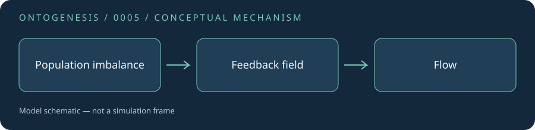

# Generation 0005 — Feedback



*Conceptual mechanism diagram; not measured simulation imagery.*

**Research question:** Can matter alter the flow that transports it?

### Implementation and parameters

Adds relaxing feedback field Q sourced by species imbalance; adds Q to streamfunction and bounds face velocity magnitude.

### Mathematical model

```math
\begin{gathered}
\Delta Q=0.12L(Q)+0.025(V-W-Q)\\
\psi=\psi_{\mathrm{external}}+0.8Q\\
\mathbf v'=\mathbf v\min(1,0.8/\mathrm{CFL})
\end{gathered}
```

CFL denotes the conservative face-speed bound.

### Visualization and observed results

Final active V 14.78%, W 63.87%; flow RMS 0.054196; Q RMS 0.205278. Raw MP4 upload introduced for video generations.

### Interpretation and limitations

Feedback is designed, not a fluid momentum equation; external forcing persists.

### Reproduction and provenance

- [Source](../../feedback.py) · [Workflow](../../.github/workflows/feedback.yml)
- [Successful CI run](https://github.com/interrupt21h/ontogenesis/actions/runs/44457878072)
- [Standalone MP4](https://github.com/interrupt21h/ontogenesis/actions/runs/44457878072/artifacts/14498178731)
- Run from repository root: `python feedback.py` after installing dependencies specified by the corresponding workflow.

[Return to experimental history](../HISTORY.md)
