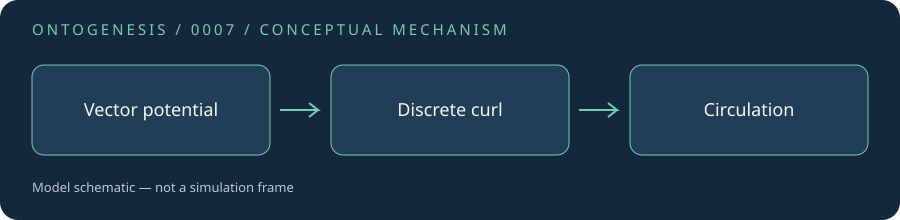

# Generation 0007 — Circulation



*Conceptual mechanism diagram; not measured simulation imagery.*

**Research question:** Can flow circulate across all three axes?

### Implementation and parameters

80³, 2,400 steps, stride 12. Three vector-potential components produce full discrete curl. Exact outgoing-face bound limits transport; assert divergence below 1e-5.

### Mathematical model

```math
\begin{gathered}
A_z=0.8Q+0.45\sin(x+0.003t)\sin y\\
A_y=0.6Q+0.45\sin(z-0.002t)\cos x\\
A_x=-0.5Q+0.45\cos(y+0.002t)\sin z\\
\mathbf v=\nabla_d\times\mathbf A,\quad \nabla_d\cdot\mathbf v=0
\end{gathered}
```

The discrete curl uses backward differences.

### Visualization and observed results

201 frames, padded 640×640 camera orbit with trilinear sampling; final active V 12.32%, W 65.97%.

### Interpretation and limitations

Discrete divergence-free transport is not Navier–Stokes; changed camera and duration.

### Reproduction and provenance

- [Source](../../circulation.py) · [Workflow](../../.github/workflows/circulation.yml)
- [Successful CI run](https://github.com/interrupt21h/ontogenesis/actions/runs/44558108736)
- [Standalone MP4](https://github.com/interrupt21h/ontogenesis/actions/runs/44558108736/artifacts/14545249000)
- Run from repository root: `python circulation.py` after installing dependencies specified by the corresponding workflow.

[Return to experimental history](../HISTORY.md)
