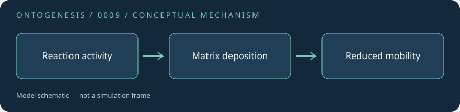

# Generation 0009 — Organization



*Conceptual mechanism diagram; not measured simulation imagery.*

**Research question:** Can activity construct a persistent environment?

### Implementation and parameters

Adds stationary matrix M, initialized to zero; matrix reduces local chemical diffusion. Face diffusivity is the arithmetic mean of neighboring coefficients, ensuring conservative fluxes.

### Mathematical model

```math
\begin{gathered}
\Delta M=0.025L(M)+0.12(A+B)(1-M)-0.003M\\
\eta=\frac{1}{1+5M}\\
D_{i+1/2}=\frac{D_i+D_{i+1}}{2}
\end{gathered}
```

$\eta$ multiplies the chemical diffusivities.

### Visualization and observed results

Final active V 5.25%, W 40.78%; M mean 0.295633, active fraction 84.47%, one component. Matrix is rendered in lavender.

### Interpretation and limitations

Connected matrix does not imply autonomous entity; M is anchored, not advected.

### Reproduction and provenance

- [Source](../../organization.py) · [Workflow](../../.github/workflows/organization.yml)
- [Successful CI run](https://github.com/interrupt21h/ontogenesis/actions/runs/44560478967)
- [Standalone MP4](https://github.com/interrupt21h/ontogenesis/actions/runs/44560478967/artifacts/14548862348)
- Run from repository root: `python organization.py` after installing dependencies specified by the corresponding workflow.

[Return to experimental history](../HISTORY.md)
