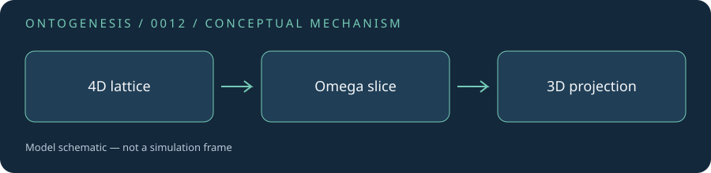

# Generation 0012 — Hypervolume



*Conceptual mechanism diagram; not measured simulation imagery.*

**Research question:** What changes when an additional spatial axis is introduced?

### Implementation and parameters

24⁴ lattice, 331,776 cells, 1,200 steps, stride 8; 20 seeded 4⁴ colonies; nine fields. H=(sin x+cos y+sin z+cos ω)/4. Reduce U/V/W diffusion to 0.085/0.045/0.0375, Q and E diffusion to 0.075, pulse diffusion scale to 0.08.

### Mathematical model

```math
\begin{gathered}
A_{ij}=0.35Q+0.25\sin(x_i+0.003t)\\
\quad\times\cos(x_j-0.002t),\quad i<j\\
v_i\gets v_i+d_jA_{ij}\\
v_j\gets v_j-d_iA_{ij}\\
\sum_i d_i v_i=0
\end{gathered}
```

Each axis pair contributes to velocity; $d_i$ denotes a backward difference.

### Visualization and observed results

151 frames, 640×640, moving interpolated 3D section traverses ω twice. Final V 0% active, W 26.65%, M active 43.58%; two components, largest 144,354 cells; Jaccard 0.979483.

### Interpretation and limitations

Fourth dimension is spatial, not time. Resolution, initialization and kinetics confound dimension comparisons.

### Reproduction and provenance

- [Source](../../hypervolume.py) · [Workflow](../../.github/workflows/hypervolume.yml)
- [Successful CI run](https://github.com/interrupt21h/ontogenesis/actions/runs/44564906262)
- [Standalone MP4](https://github.com/interrupt21h/ontogenesis/actions/runs/44564906262/artifacts/14551264078)
- Run from repository root: `python hypervolume.py` after installing dependencies specified by the corresponding workflow.

[Return to experimental history](../HISTORY.md)
