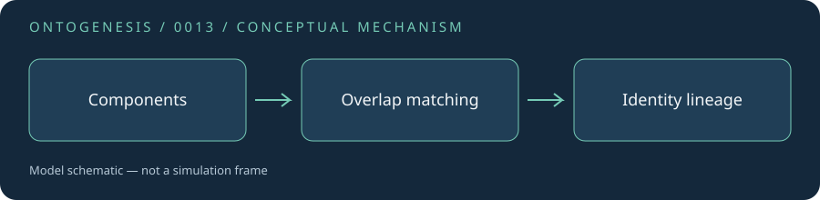

# Generation 0013 — Entities



*Conceptual mechanism diagram; not measured simulation imagery.*

**Research question:** Can emerging structures be tracked without adding objects to the physics?

### Implementation and parameters

Retains G0012 equations. Label M>0.2 using face connectivity and union-find across periodic faces. Match consecutive components by greedy IoU; candidate overlap/intersection relative to smaller component >=0.1.

### Mathematical model

```math
\begin{gathered}
\mathrm{IoU}(A,B)=\frac{|A\cap B|}{|A\cup B|}\\
\frac{|A\cap B|}{\min(|A|,|B|)}\ge0.1\\
z=\frac1n\sum_{k=1}^{n}e^{2\pi\mathrm{i}x_k/N}\\
c=\frac{N}{2\pi}\arg(z)\pmod N
\end{gathered}
```

The centroid is undefined for $|z|<0.05$.

### Visualization and observed results

Export lineages.json with identities, ages, sizes, centroids, births, splits, merges and disappearances. Final two entities, oldest age 1,152 steps, 46 events. MP4 digest identical to G0012.

### Interpretation and limitations

Identity is a heuristic observation, not biological lineage; merge absorption may appear as disappearance; sampling misses transient events.

### Reproduction and provenance

- [Source](../../entities.py) · [Workflow](../../.github/workflows/entities.yml)
- [Successful CI run](https://github.com/interrupt21h/ontogenesis/actions/runs/44566223782)
- [Standalone MP4](https://github.com/interrupt21h/ontogenesis/actions/runs/44566223782/artifacts/14552097868)
- Run from repository root: `python entities.py` after installing dependencies specified by the corresponding workflow.

[Return to experimental history](../HISTORY.md)
