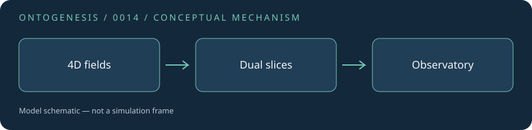

# Generation 0014 — Observatory

*Conceptual mechanism diagram; not measured simulation imagery.*

**Research question:** Can instrumentation make a 4D universe easier to interpret?

### Implementation and parameters

Preserves physical equations and tracking. Two simultaneous 3D slices separated by N/2; nearest-neighbor identity labels, interpolated scalar fields. Deterministic hue=(ID×0.61803398875) mod 1.

### Mathematical model

No new physical equation; emission–absorption compositing with identity color blending. Identity timeline displays sampled presence of up to eight longest-observed IDs.

### Visualization and observed results

1280×720 dashboard, 151 frames, live records, recent events and identity timeline; verified raw MP4 332,006 bytes.

### Interpretation and limitations

Timeline is presence, not full genealogy; no trajectory overlay. Views are different slices, not direct same-slice comparison.

### Reproduction and provenance

- [Source](../../observatory.py) · [Workflow](../../.github/workflows/observatory.yml)
- [Successful CI run](https://github.com/interrupt21h/ontogenesis/actions/runs/44566910443)
- [Standalone MP4](https://github.com/interrupt21h/ontogenesis/actions/runs/44566910443/artifacts/14551809247)
- Run from repository root: `python observatory.py` after installing dependencies specified by the corresponding workflow.

[Return to experimental history](../HISTORY.md)
