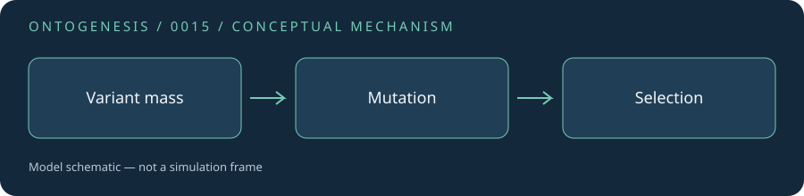

# Generation 0015 — Evolution



*Conceptual mechanism diagram; not measured simulation imagery.*

**Research question:** Can reproductive variation be inherited and selected?

### Implementation and parameters

Two variant masses Gv/Gw initialized to half each species; advected and diffused with parent populations. Variant frequency p=G/population; selection s=0.22(2E-1)-0.18P-0.12.

### Mathematical model

```math
\begin{gathered}
p_v=\frac{G_v}{\max(V,10^{-12})},\quad p_w=\frac{G_w}{\max(W,10^{-12})}\\
s=0.22(2E-1)-0.18P-0.12\\
f_0=1-s,\quad f_1=1+s\\
\mu\sim\mathcal U(0.001,0.009)\\
B_1=R_1(1-\mu)+R_0\mu\\
D=2p(1-p)
\end{gathered}
```

Diversity uses pooled local frequency.

### Visualization and observed results

Final W variant 1 frequency 14.03% vs 50% initial; pooled local diversity 0.237235; W active 24.85%, V 0%, 31 lineage events. 720p observer visualizes pooled allele.

### Interpretation and limitations

Continuous population model, not individuals. Near-zero V makes its frequency unreliable (denominator floor); diversity pools species.

### Reproduction and provenance

- [Source](../../evolution.py) · [Workflow](../../.github/workflows/evolution.yml)
- [Successful CI run](https://github.com/interrupt21h/ontogenesis/actions/runs/44578335666)
- [Standalone MP4](https://github.com/interrupt21h/ontogenesis/actions/runs/44578335666/artifacts/14557248243)
- Run from repository root: `python evolution.py` after installing dependencies specified by the corresponding workflow.

[Return to experimental history](../HISTORY.md)
