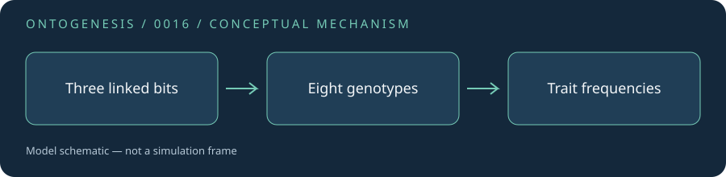

# Generation 0016 — Genetics



*Conceptual mechanism diagram; not measured simulation imagery.*

**Research question:** Can linked inherited traits create richer selection dynamics?

### Implementation and parameters

Three binary genes C/K/S for catalytic throughput, energy economy and signal response; eight genotypes per species, sixteen independently transported concentrations replacing two populations. Initialize each at one eighth of parent mass.

### Mathematical model

**Reproductive fitness**

```math
\begin{gathered}
F_g=[1+0.16(2C_g-1)]\\
\quad\times[1+0.18(2K_g-1)(1-E)]\\
\quad\times[1+0.20(2S_g-1)(2P-1)]
\end{gathered}
```

**Energy cost**

```math
Q_g=0.085+0.035C_g-0.025K_g
```

**Mutation operator**

```math
B'_g=(1-3\mu)B_g+\mu\sum_{j=0}^{2}B_{g\oplus 2^j}
```

**Genetic entropy**

```math
H=-\sum_{g=0}^{7}p_g\log_2 p_g
```

The three genes are binary; $p_g$ is pooled genotype frequency, and XOR flips one bit.

### Visualization and observed results

Final C/K/S frequencies 98.21/88.66/37.71%; genotype 110=54.13%, 111=32.93% (C,K,S order); entropy 1.59561 bits vs initial 3. Matrix active 100%, one component; 23 events. 23 independent fields.

### Interpretation and limitations

Fitness is designed; pooled entropy hides species differences. Structural saturation undermines entity differentiation. Structural deposition not genetically controlled yet.

### Reproduction and provenance

- [Source](../../genetics.py) · [Workflow](../../.github/workflows/genetics.yml)
- [Successful CI run](https://github.com/interrupt21h/ontogenesis/actions/runs/44592781876)
- [Standalone MP4](https://github.com/interrupt21h/ontogenesis/actions/runs/44592781876/artifacts/14563813752)
- Run from repository root: `python genetics.py` after installing dependencies specified by the corresponding workflow.

[Return to experimental history](../HISTORY.md)
