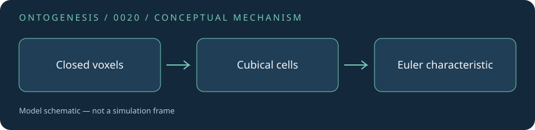

# Generation 0020 — Topological complexity



*Conceptual mechanism diagram; not measured simulation imagery.*

Status: CI passed.

### Research question and implementation

Retain G0019 physics, seed 42, 24^4 domain, 4,800 steps and stride four. Replace cut-dependent complement segmentation with periodic face-connected labels. Exclude the largest complement component as a background proxy; report other components of at least eight cells. Equal-size ties use label order, so the background choice is not uniquely translation invariant in ties. Small components may wrap, and no contractibility claim is made.

### Mathematical model

The occupied 4D voxels generate a closed cubical complex with periodic identification. Count unique k-dimensional faces for each orientation by Boolean unions of shifted masks. The Euler characteristic is

```math
\chi=\sum_{k=0}^{4}(-1)^k n_k=n_0-n_1+n_2-n_3+n_4
```

For Betti numbers over a field, the Euler–Poincare relation is

```math
\chi=\sum_{k=0}^{4}(-1)^k\beta_k
```

The implementation computes cell counts and Euler characteristic, not individual Betti numbers. Face connectivity in segmentation differs from closed-cube connectivity at corner contacts. Analytic assertions cover empty complex, one voxel, full periodic torus and a periodic one-axis tube.

### Visualization and results

Retain 1,201 frames at 24 fps, target 50.042 seconds, 720p standalone MP4. Show Euler characteristic in live sidebar and secondary complement coverage in the history chart. Export counts of all five cell dimensions and periodic complement components. Pending CI. No persistent homology, multiscale topology or winding-number detection yet; these are future work.

### Reproduction

[Source](../../topology.py) · [Workflow](../../.github/workflows/topology.yml). Python 3.12, requirements.txt and scipy==1.15.3. Run from root.

[Return to history](../HISTORY.md)

### Verified CI outcome

[Successful run](https://github.com/interrupt21h/ontogenesis/actions/runs/44651857629), [MP4](https://github.com/interrupt21h/ontogenesis/actions/runs/44651857629/artifacts/14592383068). Final Euler characteristic 0; cell counts [56148, 200178, 266887, 157706, 34849]; two structural components, one complement component, zero secondary complement candidates, 856 lineage events, entropy 1.572855 bits. Analytic self-tests passed.
