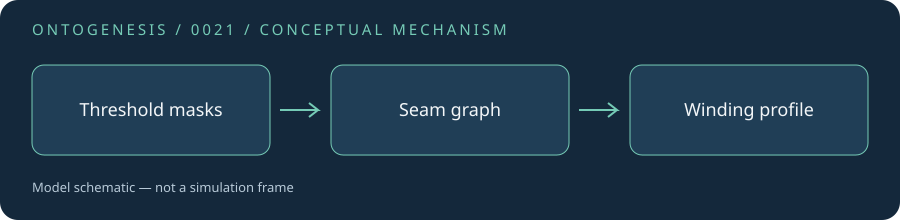

# Generation 0021 — Multiscale topological persistence



*Conceptual mechanism diagram; not measured simulation imagery.*

Status: CI passed.

### Research question and implementation

Do structural features survive changes in the concentration threshold, and do face-connected components wind around the periodic domain? Preserve G0020 physics, seed 42, 24^4 grid, 4800 steps and stride 4. Every 120 integration steps evaluate five thresholds (0.10, 0.15, 0.20, 0.25, 0.30). Label cut-box face components and link opposite faces by directed integer tile translations.

### Mathematical model

For a seam edge from component i to j assign an integer tile displacement. A spanning traversal assigns offsets; nonzero residuals on visited edges identify winding cycles.

```math
r_{ij}=p_i+d_{ij}-p_j\in\mathbb Z^4
```

An axis winds if some cycle residual has a nonzero coordinate on that axis. Record occupied coverage, Euler characteristic, number of face-connected components, winding component count, union of winding axes, and nonwinding complement sizes. The threshold profile is

```math
K_t=\{\text{closed voxels with } M>t\},\quad
\chi(K_t)=\sum_{k=0}^4(-1)^k n_k(t)
```

### Visualization and observed results

Retain G0020 observatory, 1201 frames at 24 fps (50.04 seconds). New threshold diagnostics are in metrics.json at 41 observations including the endpoint. Pending CI. Self-tests distinguish a seam-crossing two-cell blob from a complete periodic tube, and test empty and full domains.

### Interpretation and limitations

This is a multiscale Euler and winding profile, not persistent homology: no feature matching across thresholds, winding subgroup rank or individual Betti numbers are computed. Nonwinding complement components need not be contractible or functional membranes. Closed-cube Euler connectivity differs from face connectivity. No new physical mechanisms are introduced.

### Reproduction and provenance

[Source](../../persistence.py) · [Workflow](../../.github/workflows/persistence.yml). Python 3.12 and existing dependencies.

[Return to history](../HISTORY.md)

### Verified outcome

[Successful CI](https://github.com/interrupt21h/ontogenesis/actions/runs/44658944680) · [Standalone MP4](https://github.com/interrupt21h/ontogenesis/actions/runs/44658944680/artifacts/14598000801). Self-tests passed. Final threshold profile:

| Threshold | Coverage | Euler | Components | Winding axes (omega,z,y,x) |
|---|---:|---:|---:|---|
| 0.10 | 83.978% | 5 | 1 | omega,z,y,x |
| 0.15 | 50.171% | -19 | 2 | omega,z,y,x |
| 0.20 | 10.504% | 0 | 2 | omega,z |
| 0.25 | 0% | 0 | 0 | none |
| 0.30 | 0% | 0 | 0 | none |
