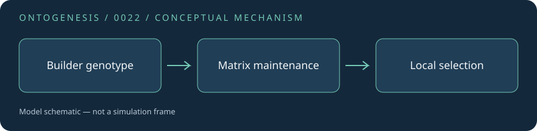

# Generation 0022 — Structural heredity



*Conceptual mechanism diagram; not measured simulation imagery.*

Status: CI passed.

### Research question and implementation

Can a costly inherited maintenance trait sustain the matrix that modifies local diffusion? Preserve G0021's lattice, seed, integration and diagnostics. Reuse the existing signal-response bit S as a pleiotropic builder trait, not a new independent gene. Builders pay an 8 percent birth-rate penalty and an additional 0.02 energy cost per birth.

### Mathematical model

```math
B=\sum_{g:S_g=1}(V_g+W_g),\qquad H=E\frac{B}{0.08+B}
```

```math
M^{n+1}=M^n+0.025\Delta M^n+D(1-M^n)-(0.005+0.006P)(1-0.65H)M^n
```

Maintenance is bounded between zero and one given nonnegative populations and bounded energy; the degradation multiplier is between 0.35 and 1. Deposit D and selective diffusion remain as in G0021. The birth penalty multiplies the previous fitness by 1-0.08 S.

### Visualization and observed results

The 50-second observatory retains dual slices and lineage diagnostics. Builder mass and mean maintenance activity are logged at every sampled frame. Multiscale topology is retained. Verified CI results are recorded below.

### Interpretation and limitations

This is a phenomenological niche-construction mechanism, not evidence of autonomous reproduction of organisms. The signal response and maintenance traits are linked by design. Compare with G0021 but separate penalty-only and maintenance-only controls are required for causal inference.

### Reproduction and provenance

[Source](../../niche.py) · [Workflow](../../.github/workflows/niche.yml).

[Return to history](../HISTORY.md)

### Verified CI outcome

[Successful run](https://github.com/interrupt21h/ontogenesis/actions/runs/44679969605) · [Standalone MP4](https://github.com/interrupt21h/ontogenesis/actions/runs/44679969605/artifacts/14605328949). 1201 frames, 50.041667 seconds, 2128983 bytes. Final active V 65.0499%, W 21.7159%, matrix above 0.20: 0%; energy mean 0.880461, genotype entropy 1.119818 bits, maintenance mean 0.219252, builder mass 9777.46343. No occupied matrix components at threshold 0.20. This does not establish that maintenance alone caused structural loss; the fitness and energy penalties changed simultaneously.

<!-- AUTO-CI-BEGIN -->

### Automated CI verification

[Successful run](https://github.com/interrupt21h/ontogenesis/actions/runs/44779025602) · [Standalone MP4](https://github.com/interrupt21h/ontogenesis/actions/runs/44779025602/artifacts/14652369635) · [Diagnostics](https://github.com/interrupt21h/ontogenesis/actions/runs/44779025602/artifacts/14652289740). Source revision: `bdc66e0d66ef1f9aa4ac02beabbb4f68d171f9fc`.

| Final metric | Value |
|---|---:|
| step | 4800 |
| slice position | 0 |
| v mean | 0.146076211 |
| w mean | 0.0553124302 |
| v active | 0.650499132 |
| w active | 0.217158565 |
| feedback rms | 0.169542655 |
| energy mean | 0.880461158 |
| energy min | 0.828315081 |
| energy depleted | 0 |
| structure mean | 0.123340924 |
| structure active | 0 |
| signal mean | 0.625207141 |
| signal active | 0.733871648 |
| recovery mean | 0.497645259 |
| trait mean | 0.558707307 |
| trait std | 0.0773434053 |
| trait min | 0.330564601 |
| trait max | 0.667420687 |
| structure jaccard | 0 |
| boundary faces | 0 |
| boundary per cell | 0 |
| metabolite v mean | 0.102047634 |
| metabolite w mean | 0.0364125495 |
| metabolite overlap | 0.0160797238 |
| genotype entropy | 1.11981789 |
| structure components | 0 |
| largest structure | 0 |
| oldest entity | 0 |
| lineage events | 205 |
| cavity candidates | 0 |
| cavity fraction | 0 |
| largest cavity | 0 |
| complement components | 1 |
| euler characteristic | 0 |
| maintenance mean | 0.219252373 |
| builder mass | 9777.46343 |

<!-- AUTO-CI-END -->

