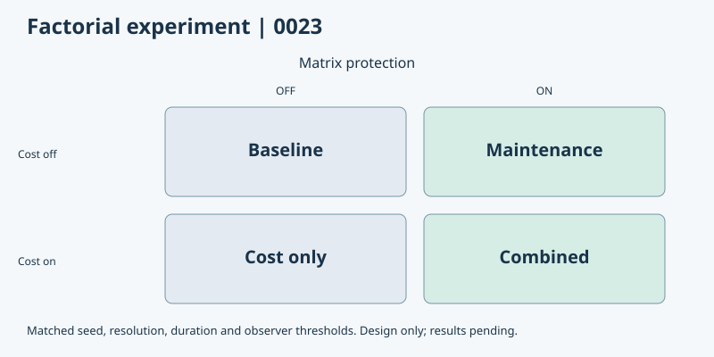

# Generation 0023 — Factorial niche construction controls

Status: CI pending.

### Research question and implementation

Separate builder fitness costs from matrix protection using a matched-seed 2-by-2 factorial experiment. All arms use seed 42, 24^4 cells, 4800 steps and identical sampling. The combined arm generates the 50-second animation; every arm exports metrics and lineage data.

| Arm | Fitness and energy cost | Matrix protection |
|---|---|---|
| Baseline | Off | Off |
| Cost | On | Off |
| Maintenance | Off | On |
| Combined | On | On |



### Mathematical model

The cost indicator C multiplies the 0.08 birth penalty and 0.02 energy surcharge. The maintenance indicator A multiplies the 0.65 protection coefficient.

```math
f_{cost}=1-0.08CS,\qquad f_{decay}=1-0.65AH
```

### Visualization and observed results

Results pending. Compare matrix coverage, energy, population activity, genotype entropy and winding profiles. Combined reproduces G0022; baseline reproduces G0021 equations.

### Interpretation and limitations

Single seed; factorial contrasts distinguish treatments at this seed but cannot establish generality. The two cost terms are bundled. No new physical mechanism is introduced.

### Reproduction and provenance

[Source](../../controls.py) · [Workflow](../../.github/workflows/controls.yml). Set ONTO_ARM to baseline, cost, maintenance or combined.
