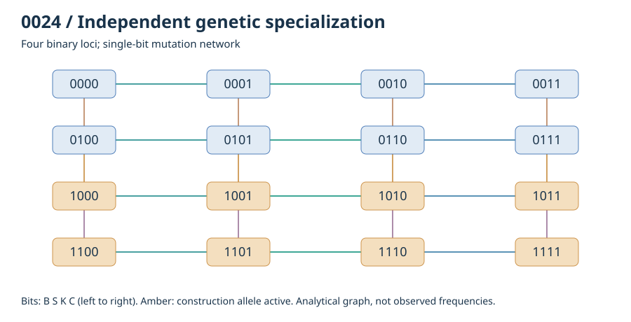

# Generation 0024 — Independent construction specialization

Status: CI pending.



## Mechanism

Four binary loci C, K, S and B encode catalysis, energy economy, signal response and construction independently. Sixteen genotypes per species, initialized uniformly. B controls matrix deposition and maintenance; S retains signal-dependent fitness. Builder birth penalty is reduced from 0.08 to 0.02 and energy surcharge from 0.02 to 0.005. These are exploratory parameter choices, not separately controlled effects.

```math
R'_g=(1-4\mu)R_g+\mu\sum_{j=0}^{3}R_{g\oplus 2^j}
```

Mutation conserves total births; runtime assertion checks this. Seed 42, periodic 24^4 lattice, 4800 steps, stride 4, 24 fps. All inherited transport and topology diagnostics retained. The entropy display range is four bits.

## Interpretation

Results pending. Independent loci and reduced costs change simultaneously, so this experiment cannot attribute outcomes to either alone. No claim of cooperation or functional compartment formation.

[Source](../../specialization.py) · [CI](../../.github/workflows/specialization.yml)

## Numerical observations

The archival revision samples steps 0, 1200, 2400, 3600 and 4800 at native resolution. Each observation records the scalar fields, sixteen genotype concentrations per species and tracked identities, with source revision and coordinate metadata. These are observations, not restart checkpoints. Independent field maps use fixed spatial cuts and consistent temporal scales; mean projections integrate over two axes. Local allele fractions are population-weighted and undefined where total population is negligible. Structural occupancy is shown at native cell centers above 0.20. The archive and scientific plates will be published after successful execution; they are not retroactively inferred from video frames.

[Scientific visualization source](../../report/field_atlas.py) · [Archive format](../../field_archive.py)
