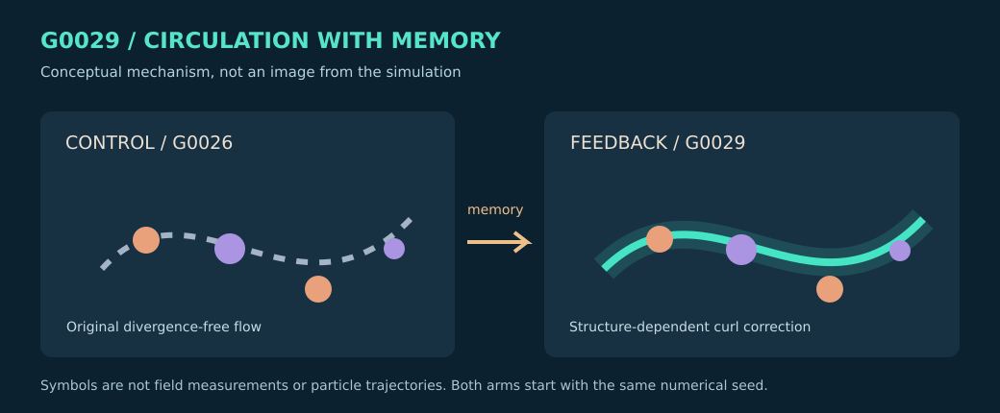

# Generation 0029 — Adaptive transport networks

[← Experiments](../EXPERIMENTS.md) · [Methodology](../METHODOLOGY.md) · [Pipeline](../PIPELINE.md)

**Status:** Implemented; CI pilot evidence pending. The featured G0028 film remains unchanged.

*Conceptual mechanism schematic; no simulated field data is depicted.*

## What are we trying?

Can a four-dimensional circulation field respond to a slowly remembered trace of activity and structure? G0029 adds a single persistent transport-memory field to the original G0026 integrator. An otherwise unchanged, same-seed G0026 arm provides a control. The result might amplify, suppress, or merely rearrange the simulated chemistry: no benefit or organism-like network is presumed.

## Model ancestry and equations

G0029 reuses G0026's periodic four-dimensional chemistry, genotypes, energy and matrix dynamics. It neither continues G0028's shocked state nor inherits G0025's separate construction allele. The default G0026 update remains unchanged; the new feedback hook is opt-in.

For structural matrix $M$, populations $V,W$, energy $E$ and memory $C$:

$$
\begin{aligned}
C_*&=\operatorname{clip}(1.6M+0.45(V+W)+0.15(1-E),0,1),\\
C(t+1)&=C(t)+0.035(C_*-C(t)),\qquad C(0)=0,\\
A_{ij}&=0.32 C,\quad i<j,\\
\delta v_i&\mathrel{+}=d_j A_{ij},\qquad
\delta v_j\mathrel{-}=d_i A_{ij}.
\end{aligned}
$$

The backward difference is $d_i f(\mathbf{x})=f(\mathbf{x})-f(\mathbf{x}-\hat{\imath})$. Its antisymmetric axis-pair construction satisfies $\sum_i d_i\delta v_i=0$ up to roundoff. The original maximum outgoing face flux constraint is applied after feedback. This creates a solenoidal circulation bias near memory gradients, **not** directed movement through physical conduits. The coefficients are exploratory, not optimized.

## Paired design

| Setting | Automatic pilot | Opt-in master |
|:--|:--|:--|
| Seed and arms | 42; unchanged and adaptive | Same |
| Periodic lattice | 12⁴; omega,z,y,x | 24⁴ |
| Steps | 180 | 4,800 |
| Sample cadence | 6 steps plus midpoint/end | 4 steps plus midpoint/end |
| Native visual samples | Float16; 4 omega hyperplanes | Same |
| Dense native keyframes | 3 float32 4D records | Same |
| Render ray grid | 56³, 960 × 540, 12 s | 96³, 1280 × 720, 60 s |

Both arms are run sequentially on GitHub-hosted CPU infrastructure. Direct numeric measurements record energy, matrix, species occupancy and activity-weighted energy. Matched adaptive-minus-control contrasts, checkpoint hashes, SHA-256 source archive validation and feedback divergence checks accompany the experiment. The five channels are matrix, species V, species W, energy, and memory, with 4D source axes **omega,z,y,x**. Float16 visual records and three float32 4D snapshots are not restart checkpoints; full integrator/RNG state is absent.

## The moving images

Actual sampled 3D volumes are ray-integrated for the film: turquoise displays memory; purple displays matrix; orange and blue display species. Camera orbit, temporal/fourth-axis interpolation, glow and fixed exposure are presentation transformations, not simulated dynamics. A 12⁴ pilot video is only a technical/artistic test, not a candidate for automatic promotion above the selected G0028 24⁴ master.

## Results and limitations

**Awaiting CI:** No measured differences, run durations, artifact IDs or visually observed outcomes should be asserted until verified. The modeler's feedback law is imposed; it is not evidence for evolved biological transport networks or improved fitness. The experiment examines a single seed, not robustness across seeds.

## Reproduce

~~~bash
python -m pip install numpy==2.2.6 scipy==1.15.3 pillow==11.2.1
python -m unittest discover -s tests -p test_adaptive_transport.py -v
python adaptive_transport.py --n 12 --steps 180 --stride 6 --omega-planes 4 --out g0029-pilot.npz --metadata g0029-pilot.json
python adaptive_transport_render.py --input g0029-pilot.npz --metadata g0029-pilot.json --movie ontogenesis-0029-preview.mp4 --poster ontogenesis-0029-preview.png --seconds 12 --fps 24 --width 960 --height 540 --rays 56
~~~

[Source](../../adaptive_transport.py) · [Renderer](../../adaptive_transport_render.py) · [Workflow](../../.github/workflows/adaptive-transport.yml) · [Tests](../../tests/test_adaptive_transport.py).

The high-fidelity workflow must be dispatched manually with its full_resolution input. G0030 ecological succession remains a proposal, not a completed experiment.
