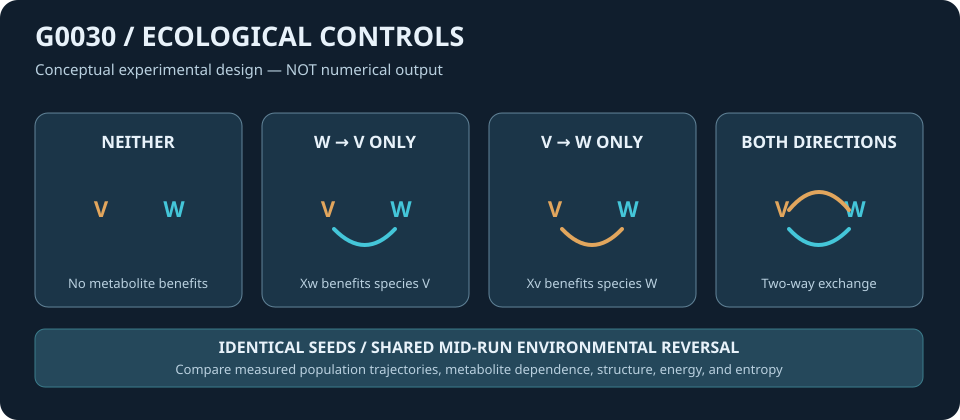

# Generation 0030 — Ecological succession with controls

[← Experiment atlas](../EXPERIMENTS.md) · [Methodology](../METHODOLOGY.md) · [CI workflow](../../.github/workflows/ecological-succession.yml)

**Status:** Implemented; pilot numerical outcomes are pending CI. The title is a research question, **not** a claim of demonstrated succession or mutualism.

*Conceptual experimental layout, not a measured simulation image.*

## Research questions

G0017 introduced reciprocal cross-feeding along with other changes, which made it impossible to attribute any ecological outcome specifically to metabolite exchange. G0029 showed that changing transport can benefit one simulated population's coverage while reducing another's. G0030 asks which directional metabolite benefits matter when the spatial environment changes: **neither, W to V only, V to W only, or both**.

Is there a reproducible change of dominant populations after a shared environmental challenge? Does metabolite exchange preserve coexistence, or merely shift which population wins? Neither outcome is assumed.

## Numerical ancestry and factorial design

The physical ancestry is the existing G0026 integration loop (itself derived from G0023), not the G0029 adaptive transport arm. All other kinetics, inherited genotype concentrations, transport, structural deposition, and stochastic update schedules are retained. The two G0030-only options are inert by default; tests verify baseline state hashes remain identical to the historical G0026 run.

| Controlled configuration | W-secreted Xw benefits V | V-secreted Xv benefits W |
|:--|:--:|:--:|
| Neither | No | No |
| W → V only | Yes | No |
| V → W only | No | Yes |
| Both / historical interaction | Yes | Yes |

The existing reproductive multiplier for genotype g in recipient species i uses

$$
B_{i,g}=b_i\,0.45\,\frac{X_{\mathrm{donor}}}{0.12+X_{\mathrm{donor}}}(0.35+0.65K_g),
\qquad b_i\in\{0,1\}.
$$

The switch disables recipient bonus **and associated metabolite uptake**, but not secretion by the donor. Consequently, the experiment identifies consequences of disabling these recipient interactions; donor metabolite concentrations need not remain fixed.

At the midpoint, all four matched arms experience the same *externally imposed* mean-preserving inversion of the spatial energy-supply gradient:

$$
S_{\mathrm{after}}(\mathbf{x})=2\overline S-S_{\mathrm{before}}(\mathbf{x}).
$$

This is a deterministic change of replenishment location, not autonomous organism behavior. At step T/2 the observation precedes the first update under the new field. The mean supply is unchanged.

## Automatic pilot

The bounded pilot uses **16⁴ periodic lattice cells, 1,200 updates, two seeds (42 and 73), and all four arms per seed**. All eight model runs execute sequentially on standard GitHub-hosted CPU runners; there is no GPU or external compute. Measurements are taken every 30 steps and immediately around the switch.

Observed fields and derived metrics include species V/W active coverage (concentration >0.1), co-occupied fraction (>0.1 for both), population means, metabolite means and overlap, energy, matrix mean/coverage (>0.2), and population-weighted entropy of the 16 species-genotype categories. The JSON retains complete time series, same-seed differences versus the neither arm, before/late mean windows, and matched initial-state hashes. The numerical PNG shows the first seed's six measured curves; it does not depict organisms.

The pilot is a **sensitivity screen** with limited resolution and two seeds, not a statistical ensemble and not a full-domain study. The 24⁴ / 4,800-step / four-arm version is manually gated and has **not** been run.

## Actual results and limitations

**Pending CI.** Measured numerical values, source revision, artifacts and uncertainty will be added after successful verification. Neither a shift in abundance nor high genotype entropy proves functional self-maintenance, stable ecological succession or the autonomous evolution of new capabilities. The model uses transported continuous genotype mass, not discrete reproductive individuals; the genotype repertoire remains fixed.

## Reproduction

~~~bash
python -m pip install numpy==2.2.6 scipy==1.15.3 matplotlib==3.10.3 pillow==11.2.1
python -m unittest discover -s tests -p test_ecological_succession.py -v
python ecological_succession.py --n 16 --steps 1200 --stride 30 --seeds 42,73 --out g0030-pilot.json --plate g0030-pilot.png
~~~

[Source](../../ecological_succession.py) · [Integrator](../../consolidation.py) · [Tests](../../tests/test_ecological_succession.py) · [Workflow](../../.github/workflows/ecological-succession.yml)

The next proposed experiment, G0031, will address whether structures provide measurable functional protection or metabolism, rather than merely exhibiting geometric boundaries.
