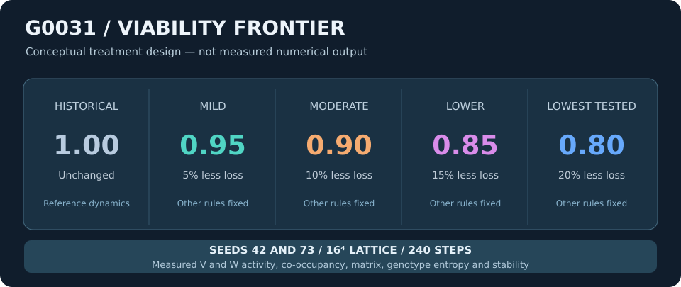

# Generation 0031 — Population Viability Frontier

[← Experiment atlas](../EXPERIMENTS.md) · [G0030](0030.md) · [Reproduction guide](../PIPELINE.md)

**Status:** Controlled numerical pilot implemented; outcome pending CI verification. No result is inferred from the experiment's name or conceptual diagram.

*Experimental protocol illustration, not a plot of observed species coverage.*

## The question

G0030 showed that species V's thresholded activity disappeared before the intended environmental intervention. Even moving the intervention to steps 12, 24 or 48, or leaving the environment unchanged, failed to preserve V's activity. Before investigating mutualistic structures or functional compartments, the model needs a regime in which two populations can remain active simultaneously.

G0031 therefore asks whether a **moderate reduction in V's existing loss rate**, rather than a new mechanism or a larger lattice, changes the population outcome. This is a deliberately external numerical control, not evolved survival behavior.

## Numerical ancestry

The integrator, seeded initialization, both directions of existing cross-feeding, reproduction, transport, energy balance and structure remain those of G0026. There is no imposed environmental inversion. The only additional option is the externally specified multiplier \(\alpha\) in the V-loss term:

\[
D_V(\mathbf{x})=0.097\,\alpha+0.009\,h(\mathbf{x}).
\]

At \(\alpha=1\) the calculation remains the historical G0026 baseline. W's loss rate is unchanged, as are all gene and transport rules. The regression suite compares numerical hashes of the original default and explicit baseline.

| Matched treatment | Multiplier \(\alpha\) |
|:--|--:|
| Historical baseline | 1.00 |
| Mild loss reduction | 0.95 |
| Moderate loss reduction | 0.90 |
| Larger loss reduction | 0.85 |
| Lowest tested | 0.80 |

## Scope and instrumentation

The bounded screen uses **two seeds (42 and 73), 16⁴ lattice cells, 240 steps, and six-step observations** in each of five independently initialized arms. Recorded observables include thresholded V/W occupancy (>0.1), simultaneous active coverage, mean concentrations, matrix mean and coverage, energy, pooled genotype entropy, and observed final/last-active windows.

The first exploratory version tried severe multipliers down to 0.25. The 0.75 multiplier caused V dominance and W disappearance at the pilot endpoint for seed 42; the 0.25 treatment subsequently violated a nonnegativity assertion. Those trajectories are **not** counted as valid completed experiment results. The subsequent 0.80–1.00 screen retains all numerical finite-value and nonnegativity checks. No values are clipped to make invalid experiments pass.

## Interpretation

**Outcome pending verification.** A numerical trajectory where both thresholded population fields remain active would be interesting, but would not prove biological individuals, mutualism, autonomous adaptation, or long-term stability. A useful result must be replicated and inspected over longer horizons, ideally with native field recordings before proposing a spatial cinematic edition. No automatic 24⁴ full simulation is requested here.

## Reproduce

~~~bash
python -m pip install numpy==2.2.6 scipy==1.15.3 matplotlib==3.10.3 pillow==11.2.1
python -m unittest discover -s tests -p test_viability_frontier.py -v
python viability_frontier.py --n 16 --steps 240 --stride 6 --seeds 42,73 --out g0031-pilot.json --plate g0031-pilot.png
~~~

[Source](../../viability_frontier.py) · [Model](../../consolidation.py) · [Tests](../../tests/test_viability_frontier.py) · [Workflow](../../.github/workflows/viability-frontier.yml).

Functional compartmentalization remains a proposed successor after a sufficiently stable population baseline is established.
