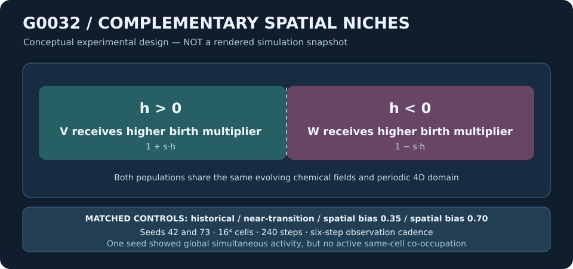

# Generation 0032 — Complementary Spatial Niches

[← Experiment atlas](../EXPERIMENTS.md) · [G0031](0031.md) · [Numerical conventions](../METHODOLOGY.md)

**Status:** Verified two-seed matched numerical pilot. Spatial preference helped both populations remain globally active in one seed, but neither active same-cell co-occupation nor long-term stability was demonstrated.

*Conceptual parameter-control design, not measured four-dimensional concentration fields.*

## Question and ancestry

G0031 found a seed-dependent numerical boundary between W-dominated and V-dominated outcomes when the existing V mortality rate was changed. It did not find active overlap at any endpoint. G0032 asks whether **spatially complementary static growth preferences** can support both populations in different parts of the same four-dimensional chemical universe, without introducing new organisms or an evolved decision rule.

G0032 extends the previously unchanged G0026 integrator with a fully optional spatial preference parameter \(s\). The preexisting scalar terrain is

\[
h(x,y,z,\omega)=\tfrac14(\sin x+\cos y+\sin z+\cos \omega).
\]

When \(s>0\), the existing V and W reproductive fluxes are multiplied by \(1+s h\) and \(1-s h\), respectively. These are *external fixed preferences* for complementary spatial environments, not learned traits or speciation. With \(s=0\), the historical numerical code path and state hashes remain unchanged.

The study has four matched arms: the original V mortality at multiplier 1.00 with \(s=0\); a near-transition control at V mortality multiplier 0.97 with \(s=0\); and matched near-transition arms with \(s=0.35\) and \(s=0.70\). All other rules, including both metabolite cross-feeding directions and the absence of a seasonal supply reversal, are shared. Seeds **42 and 73** each start from matching reset states.

## Measured observables

At **16⁴ cells for 240 steps**, sampled every six steps, the workflow records V/W concentration, thresholded active coverage, same-cell co-occupation, the existing matrix and genotype statistics, plus each population's concentration-weighted mean of the imposed habitat field. These habitat centroids are numerical diagnostics, not evidence of individual spatial objects. The native four-dimensional field arrays are **not archived** by this experiment; the published figure is a plot of measured time series.

## Results and limitations

### Verified numerical result: spatial partition without same-cell co-occupation

The [matched G0032 pilot](https://github.com/interrupt21h/ontogenesis/actions/runs/45335396705) passed CI at source revision \`6f64f3e7eb66c245385d2801306f7f039eef0d66\`. It ran four treatments for each of two independently reset seeds, **16⁴ cells** and **240 steps**, with a six-step observation cadence. Same-seed initial state hashes matched. The historical model's default was regression-checked and its numerical invariants remained enforced.

**Endpoint activity** — percentage of cells in which each population exceeds the 0.1 concentration threshold:

| Matched treatment | Seed 42 V | Seed 42 W | Seed 73 V | Seed 73 W |
|:--|--:|--:|--:|--:|
| Historical decay, no niche | 0.00% | 90.51% | 0.00% | 89.58% |
| V loss ×0.97, no niche | 94.91% | 0.00% | 0.00% | 90.36% |
| V loss ×0.97, niche strength 0.35 | 0.00% | 78.09% | **67.17%** | **1.83%** |
| V loss ×0.97, niche strength 0.70 | 0.00% | 39.60% | **67.67%** | **6.40%** |

**No treatment exhibited active same-cell co-occupation at the endpoint.** However, both populations were globally active in **seed 73's two niche-separated arms**, unlike its no-niche reference. This is *global simultaneous persistence with spatial partitioning*, not same-cell coexistence. Their concentration-weighted mean habitat coordinates were distinct (V minus W: **0.537** for strength 0.35 and **0.500** for strength 0.70), consistent with differing use of the imposed spatial preference. Population concentration remaining beneath a threshold in one region does not prove literal absence.

The result did **not** generalize to seed 42, and nothing here establishes long-term stable coexistence, autonomous adaptation, species differentiation, or functional interdependence. Habitat preferences are *externally prescribed*, not encoded in evolving genotypes. The promising next control is a longer-horizon, matched run focused on whether seed 73's partition survives, replicated across additional seeds before any full-domain cinematics.

[Measured G0032 time-series figure](https://github.com/interrupt21h/ontogenesis/releases/download/atlas-media/g0032-pilot.png) · [Full numerical archive](https://github.com/interrupt21h/ontogenesis/releases/download/atlas-media/g0032-pilot.json) · [Successful numerical workflow](https://github.com/interrupt21h/ontogenesis/actions/runs/45335396705).

The spatial separation result must be tested over longer durations and more seeds before interpreting it as a robust or self-maintaining ecology. A numerically viable two-population region is not equivalent to artificial life.

### Longer-horizon result: independently rerun to step 480

A separate [successful G0032 longer-horizon workflow](https://github.com/interrupt21h/ontogenesis/actions/runs/45338017117) independently recomputed the same seeded treatments to **step 480** at **16⁴**, checking numerical initialization against the archived pilot. The previous 240-step experiment did not preserve a complete restartable field state: this is an **independent same-seed rerun**, not a claimed checkpoint restart.

| Step-480 treatment | Seed 42: V active | Seed 42: W active | Seed 73: V active | Seed 73: W active |
|:--|--:|--:|--:|--:|
| Near-transition, no niche | 54.02% | 0.00% | 0.00% | 87.45% |
| Complementary niche strength 0.70 | 0.00% | 62.06% | **64.26%** | **22.84%** |

Only the **seed-73 spatially biased arm** retained both species globally at step 480. In that arm, simultaneous above-threshold activity in the same cell increased from zero at step 240 to approximately **2 out of 65,536 cells** at step 480 (roughly 0.003% of the four-dimensional lattice). This tiny overlap is not evidence of functional mutualism.

[Recorded continuation plot](https://github.com/interrupt21h/ontogenesis/releases/download/atlas-media/g0032-persistence.png) · [Complete measured JSON](https://github.com/interrupt21h/ontogenesis/releases/download/atlas-media/g0032-persistence.json) · [Successful workflow](https://github.com/interrupt21h/ontogenesis/actions/runs/45338017117).

### Native four-dimensional field visualization

A subsequent [verified native-field recording and rendering workflow](https://github.com/interrupt21h/ontogenesis/actions/runs/45407767981) independently reran **seed 73** for two treatments (near-transition without spatial bias, and the complementary 0.70 niche). It archived actual float32 four-dimensional arrays of **V, W, and matrix** at **21 numerical samples spanning steps 0–480**. Its cinematic presents the genuine **fixed ω=8 three-dimensional hyperplane**, rotated solely by the display camera. The renderer does **not** interpolate physical timesteps or infer organisms from aggregate metrics.

[Watch the actual G0032 spatial edition](https://github.com/interrupt21h/ontogenesis/releases/download/atlas-media/ontogenesis-0032-spatial.mp4) · [Verified source frame](https://github.com/interrupt21h/ontogenesis/releases/download/atlas-media/ontogenesis-0032-spatial.png) · [Native 4D field archive](https://github.com/interrupt21h/ontogenesis/releases/download/atlas-media/g0032-native-fields-seed73.npz) · [Field provenance](https://github.com/interrupt21h/ontogenesis/releases/download/atlas-media/g0032-native-fields-seed73.json) · [Rendering provenance](https://github.com/interrupt21h/ontogenesis/releases/download/atlas-media/ontogenesis-0032-spatial.render.json).

This authentic spatial edition is **different** from the original measured-data animation and does not replace G0028's featured cinematic. Both use external static niches; they do not show autonomous organisms or prove long-term coexistence.

### Observed four-dimensional interfaces: direct native-field analysis

A separate [verified four-dimensional interface calculation](https://github.com/interrupt21h/ontogenesis/actions/runs/45410140099) used **the actual archived float32 4D fields** from the seed-73 native-recording run, not video pixels or a two-dimensional projection. At step 480, the strong spatial-niche treatment had **42,113 V-active cells**, **14,966 W-active cells**, **2 simultaneously active cells** and **2,806 distinct lattice faces** shared by *exclusively V-active* and *exclusively W-active* neighboring cells. Periodic adjacency was measured along all four simulation axes.

The matched no-niche treatment had **0 V-active cells**, **57,309 W-active cells**, zero overlapping active cells and zero exclusive V/W contacts. An edge contact is a property of a concentration-thresholded lattice, **not a biological cell membrane or measured metabolite transfer**. The result is confined to one seed, one model, and a finite 480-step horizon.

[Measured 4D contact and overlap plot](https://github.com/interrupt21h/ontogenesis/releases/download/atlas-media/g0032-spatial-interface.png) · [All 21 sampled numerical measurements](https://github.com/interrupt21h/ontogenesis/releases/download/atlas-media/g0032-spatial-interface.json) · [Verified numerical workflow](https://github.com/interrupt21h/ontogenesis/actions/runs/45410140099).

## Reproduction

~~~bash
python -m pip install numpy==2.2.6 scipy==1.15.3 matplotlib==3.10.3 pillow==11.2.1
python -m unittest discover -s tests -p test_niche_screen.py -v
python niche_screen.py --n 16 --steps 240 --stride 6 --seeds 42,73 --out g0032-pilot.json --plate g0032-pilot.png
~~~

[Source](../../niche_screen.py) · [Model](../../consolidation.py) · [Tests](../../tests/test_niche_screen.py) · [Workflow](../../.github/workflows/niche-screen.yml)
